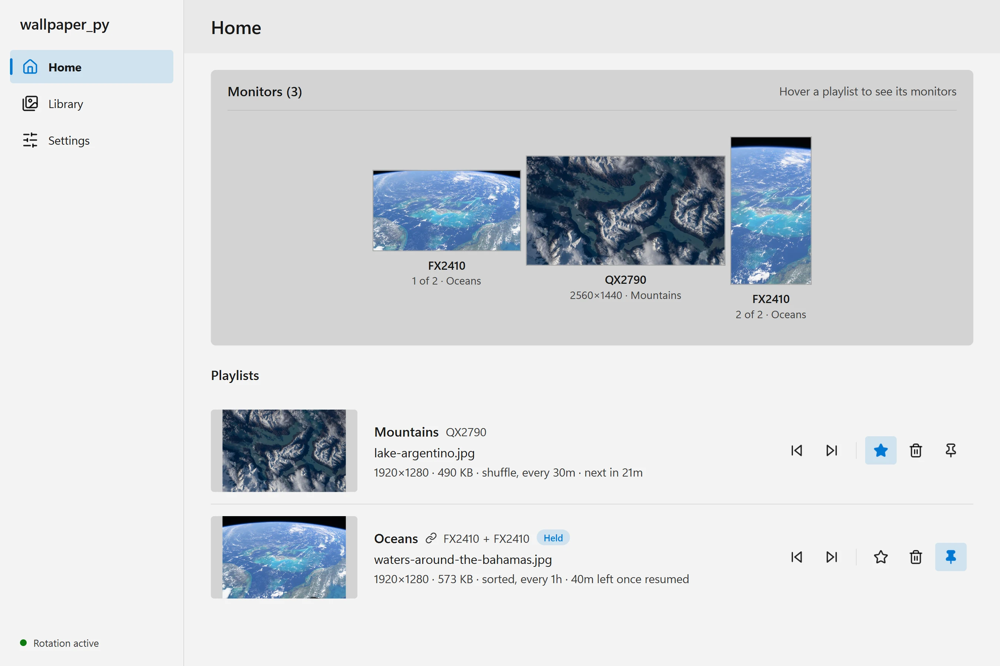
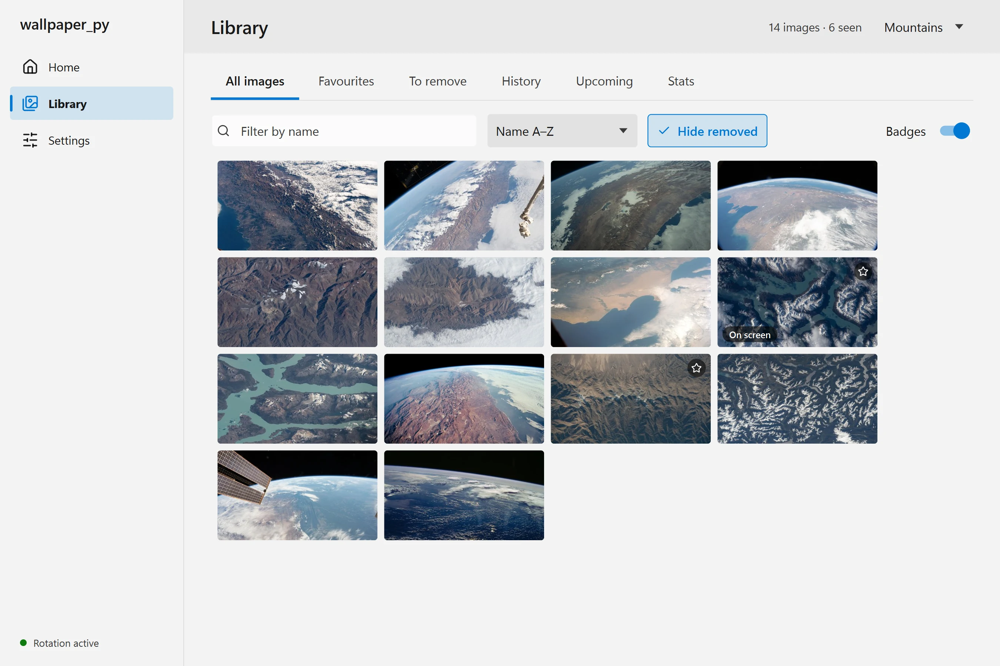
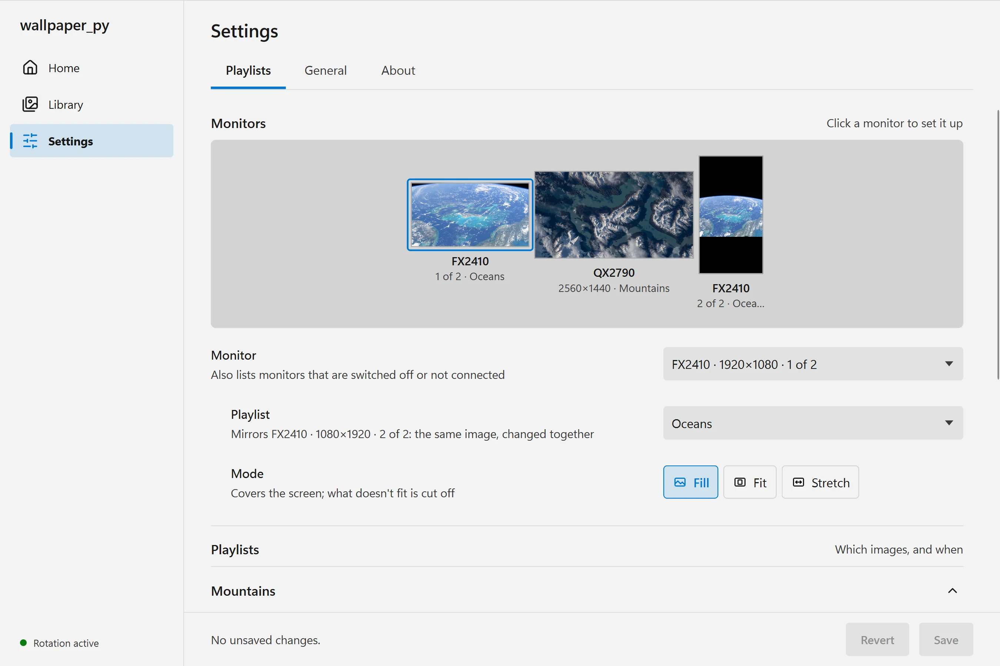

# wallpaper_py

Per-monitor wallpaper management for **Windows** and **KDE Plasma** (6, Wayland).

The goal is a tray app that runs wallpaper playlists per monitor (or per group
of mirrored monitors), keeps history and favourites, and browses large
libraries (10k+ images). See [todo.md](todo.md) for the feature list,
[docs/plan.md](docs/plan.md) for the phases and
[docs/architecture.md](docs/architecture.md) for the design.

**Status:** the core, the Windows and KDE backends, the playlist service,
the tray app and the window (Home, Library, Settings) exist. Left: trying
KDE by hand on Kubuntu, then polish.

<picture>
  <source media="(prefers-color-scheme: dark)" srcset="docs/images/home-dark.webp">
  <source media="(prefers-color-scheme: light)" srcset="docs/images/home-light.webp">
  
</picture>

<picture>
  <source media="(prefers-color-scheme: dark)" srcset="docs/images/library-dark.webp">
  <source media="(prefers-color-scheme: light)" srcset="docs/images/library-light.webp">
  
</picture>

<details><summary>Settings</summary>

<picture>
  <source media="(prefers-color-scheme: dark)" srcset="docs/images/settings-dark.webp">
  <source media="(prefers-color-scheme: light)" srcset="docs/images/settings-light.webp">
  
</picture>

</details>

The photos are NASA's (crew Earth observations, public domain); the
screenshots are made by `scripts/screenshots.py`, with made-up monitors.

## Install

Python 3.12+, managed with [uv](https://docs.astral.sh/uv/).

```
uv sync                           # creates .venv with the package and dev tools
uv run wallpaper list             # or activate .venv and run `wallpaper` directly
uv run python scripts/check.py    # black, mypy, pylint, pytest (as CI does)
```

On Linux, PySide6 needs a few system libraries that a desktop install
usually has already (CI's minimal Ubuntu installs them): Ubuntu / Kubuntu
`sudo apt install libegl1 libgl1 libxkbcommon0 libfontconfig1 libdbus-1-3`
(and `libxcb-cursor0` for X11), Arch `sudo pacman -S --needed libglvnd
libxkbcommon fontconfig dbus xcb-util-cursor`.

On KDE Plasma the app talks to Plasma through two tools that ship with it:
`kscreen-doctor` (KScreen; Arch: `libkscreen`) and `busctl` (systemd). A
monitor's id is its connector (`DP-4`); its name comes from its EDID.

## CLI

```
wallpaper list [--all]
wallpaper set IMAGE --monitor NAME [--mode fill|fit|stretch]
```

- `list` shows each monitor's name, position, size, current wallpaper and id;
  `--all` includes monitors that are known but detached (switched off).
- `--monitor` takes a monitor name, a unique part of it (`zero` for
  `ZeroMOD`), or the full id. **Numbers are refused on purpose**: monitor
  order changes when a monitor is switched off, which is exactly how a
  wallpaper ends up on the wrong screen.
- `--mode` (default *fill*): the image is always rendered to the monitor's
  exact resolution with this mode, so each monitor can have its own. Windows
  has one position for all monitors; it is kept at *fill* (switched from
  *tile* or *span*, which tools that set one combined image use, e.g. John's
  Background Switcher). Close such tools first, or they will overwrite the
  result. On KDE each desktop (in every activity) is set to the *Image*
  wallpaper at *Scaled and Cropped*; a slideshow on that monitor is
  replaced.

### Playlists

```
wallpaper tray                               # the app, in the tray (what starts at login)
wallpaper run [--poll SECONDS]               # the app, headless in this terminal (Ctrl+C stops)
wallpaper status                             # playlists, monitors, current, upcoming
wallpaper next|prev|fav|unfav|remove [TARGET]  # TARGET: playlist or monitor name
wallpaper fav|unfav|remove|unremove --image PATH  # any image instead of the current one
wallpaper pick IMAGE [TARGET]                # show IMAGE now (any directory)
wallpaper upcoming [TARGET] [-n N]           # the next N images, one path a line
wallpaper hold|resume [TARGET]               # stop / restart rotating
wallpaper stats [TARGET] [--rescan]          # images seen / unseen / skipped; the lists
wallpaper reset-cycle TARGET [--yes]         # every image unseen again (asks first)
wallpaper ui [home|library|settings]         # open the window on a page (see below)
```

Playlists are set up in the window's Settings page (`wallpaper ui
settings`); the app keeps them with its state, so there is no settings file
to edit.

- A playlist rotates a directory (recursively), *sorted* (natural order) or
  *shuffled* (every image once before any repeats; the order is kept across
  reboots), on one monitor or a **mirrored group**.
- The interval counts *active* time since the last change: it pauses while
  the session is locked or idle, while none of the playlist's monitors is
  attached, and while the PC sleeps. `next` / `prev` / `pick` start it again.
- `pick IMAGE` shows any image, from any directory, as if `next` had
  chosen it: `prev` goes back to what was shown before. A picked image from
  the playlist's own directory counts as seen in the current shuffle cycle;
  in a sorted playlist, rotation goes on from it. The image must be one
  Pillow can open.
- `hold` stops a playlist rotating until `resume` (the tray has a *Hold*
  toggle too); `next`, `prev` and `pick` still work, and the held state
  survives restarts. *Changes: Manually* in Settings makes a playlist
  that never changes by itself, only by `next` / `prev` / `pick` (it shows
  nothing until you pick or step it once). `status` and the tray show which
  playlists are held or manual.
- A monitor that is switched off is never written to: its playlist waits
  (a group keeps going on its other members) and the monitor gets the
  current image when it comes back.
- `fav` and `remove` append the current image to `favourites.txt` /
  `to-remove.txt` (one full path per line, editable by hand); `unfav` and
  `unremove` take an image off again. `remove` only lists the image and
  hides it from rotation (and shows the next one); deleting is up to you.
  With `--image PATH` they act on that image instead (any path, no
  playlist); a playlist showing an image listed this way, or by hand,
  moves on at the app's next tick: within a few seconds, or when it
  starts.

### The app

`tray` and `run` start the same app; only one can run at a time (per
user). It rotates the playlists, and the other commands (`status`, `next`,
...) are sent to it, so they never collide with a change in progress. When
no app is running, they fail ("wallpaper_py isn't running"; `wallpaper tray`
starts it): the commands never start it. `list` and `set` work without the
app. `--verbose` (before the command: `wallpaper --verbose next`) logs the
daemon the command asked and the raw reply.

The tray menu has a section per playlist (its monitors by name, the current
image, which opens on click, *Next*, *Previous*, a *Favourite* toggle,
*Remove*, and a *Hold* toggle unless it is manual; the header says *held* or
*manual*), then *Open wallpaper_py* (the window on Home), *Library*,
*Settings…*, *Start at login* and *Quit*. Left-click
opens the window on Home. The icon turns
grey while rotation is paused and shows a red badge if the app has
stopped (a favourites or to-remove file it can't read; it starts again
once the file is fixed). Start at login uses the per-user Run key on Windows and
`~/.config/autostart` on Linux; it starts `python -m wallpaper_py tray`
from the current environment (`pythonw` on Windows, so no console window
opens). The tray app logs
to `wallpaper.log` in the per-user log directory (on Windows
`%LOCALAPPDATA%\wallpaper_py\Logs`, on Linux
`~/.local/state/wallpaper_py/log`). Everything it adds to your system
(start at login, files, sockets, what it changes on the desktop) and how to
remove it all: [docs/system-integration.md](docs/system-integration.md).

The window runs in a separate process (`wallpaper ui`), started when it
is opened and gone when it closes, so it costs nothing while closed. It has
a sidebar with its pages (Home, Library, Settings) and the app's status
(rotation active or paused). Opening it while that process runs just
brings it to the front on the page asked for; it starts the app if needed
and closes when the app quits. It follows the system's light / dark mode
and accent. It logs to `ui.log` next to `wallpaper.log`.

- **Home** (`wallpaper ui`, tray *Open wallpaper_py*): the monitors to
  scale with their current wallpapers, and a row per playlist with
  previous / next, favourite, remove and hold. Pointing at a row outlines
  its monitors.
- **Settings** (`wallpaper ui settings`, tray *Settings…*). *Playlists*:
  click a monitor in the drawing (or pick it from the *Monitor* list, which
  also has monitors that are switched off or not connected) to choose its
  playlist (*None*, a playlist, or *New playlist…*; monitors on one
  playlist mirror it) and its mode (fill, fit, stretch). Below, the
  playlists, one open at a time (the others show a summary): name,
  folder, order, changes (every *duration* of active time, or manually)
  and the monitors it is shown on. *General*: pausing while locked or
  idle, and where favourites.txt / to-remove.txt are. *About*: the version
  and every data location, with *Open folder* and *Copy path*. *Save*
  sends everything to the app, which uses it at once (a changed mode or
  folder shows before the page says it is saved). Problems show next to
  their field and keep *Save* off. Unsaved changes stay while you visit
  other pages; closing the window with them asks first.
- **Library** (`wallpaper ui library`, tray *Library*): a playlist's
  images (picked at the top right) as thumbnails, in tabs: *All images* (its folder), *Favourites*,
  *To remove*, *History*, *Upcoming*, and *Stats* (images, seen and unseen
  in this shuffle cycle, skipped; the lists; *Rescan* and *Reset
  cycle…*). Each grid filters by name and sorts; badges mark favourites,
  images to remove and what is on screen. A click opens an image over the
  page: ← / → go through the grid's images, the wheel zooms, and it can be
  marked a favourite or to remove, or shown now on a playlist. The
  thumbnails are made in the background while the window is open (every
  playlist's folder and the lists) and kept in the thumbnail cache, so the
  next opening is fast; it deletes the ones no image needs any more. The
  playlist, the tab and each grid's sort are remembered.

Other programs can drive the app over the same socket: see
[docs/protocol.md](docs/protocol.md).

`python -m wallpaper_py ...` works too.

## Development

```
python scripts/check.py            # black --check, mypy (strict), pylint, pytest
python scripts/check.py black      # format
```

CI runs the same on Windows and Ubuntu. Tests marked `windows` or `kde` read
the real desktop (never change it) and are skipped elsewhere. Qt tests run offscreen
(`tests/conftest.py`) with per-test data directories, so they never show an
icon or reach a running app. What only a real desktop can show is checked
by hand: [docs/desktop-checks.md](docs/desktop-checks.md).

`spikes/` holds throwaway experiments (monitor behaviour when switched off,
the 20k-image grid prototype); see [spikes/README.md](spikes/README.md).
