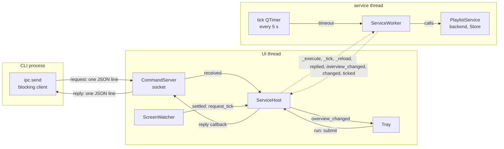
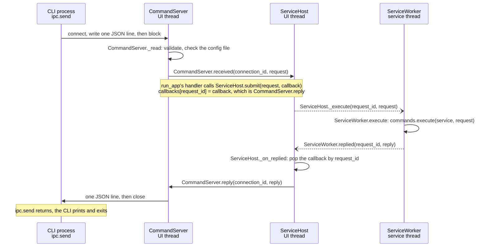
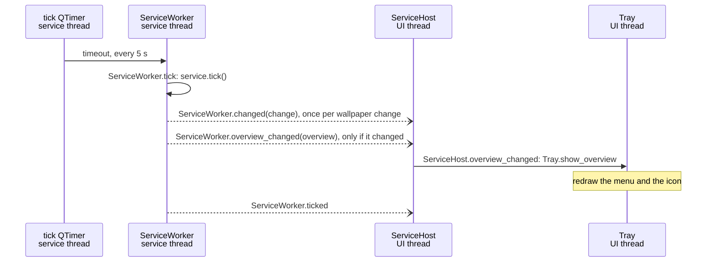

# App wiring

How the app's objects talk to each other: which thread each lives on, and
every signal connection between them. Written with class, signal and slot
names only (no line numbers); `tests/test_docs.py` checks that every
`Class.member` named here still exists, so renames can't silently leave this
page behind. For the reasons behind the design, see
[architecture.md](architecture.md#app-shell).

Qt basics used below: `signal.emit(...)` calls every slot connected to the
signal. Within one thread that is a direct call. A **queued** connection
(used for every connection that crosses threads) instead posts the call to
the receiving thread's event loop, so the sender never waits.

## Threads and who lives where

| Thread | Objects |
|---|---|
| **UI** (main thread, Qt event loop) | `QApplication`, `CommandServer` (socket), `Tray`, `ScreenWatcher`, `ServiceHost` |
| **service** (`QThread` "playlist-service") | `ServiceWorker` and everything it creates on that thread: the tick `QTimer`, COM (`backends.thread_scope`), the backend, the SQLite `Store`, the `PlaylistService` |
| **CLI** (a separate process) | `ipc.send`: blocking client, no event loop |

Only the service thread ever touches the `PlaylistService`, so the core needs
no locks. The UI thread never waits on it (except once, at shutdown).

## Overview

Solid arrows are direct calls within one thread; dashed arrows are queued
signals that cross from one thread to another.

## Connections

UI thread -> service thread (all queued; `ServiceHost` is the only door in):

| Signal | Slot | Carries |
|---|---|---|
| `QThread.started` | `ServiceWorker.start` | - |
| `ServiceHost._execute` | `ServiceWorker.execute` | request id, `Request` |
| `ServiceHost._tick` | `ServiceWorker.tick` | - (an extra tick) |
| `ServiceHost._reload` | `ServiceWorker.reload` | - |
| `ServiceHost._stop` | `ServiceWorker.stop` | - |

Service thread -> UI thread (all queued):

| Signal | Slot / re-emitted as | Carries |
|---|---|---|
| `ServiceWorker.replied` | `ServiceHost._on_replied` (calls the stored callback) | request id, `Reply` |
| `ServiceWorker.overview_changed` | `ServiceHost._on_overview` -> `ServiceHost.overview_changed` | `Overview` |
| `ServiceWorker.changed` | `ServiceHost.changed` | `Change` |
| `ServiceWorker.ticked` | `ServiceHost.ticked` | - |

Inside the service thread: the tick `QTimer.timeout` -> `ServiceWorker.tick`
every 5 s.

Inside the UI thread (direct):

| Signal | Slot |
|---|---|
| `CommandServer.received` | the handler in `runtime.run_app` -> `ServiceHost.submit` (reply callback: `CommandServer.reply`) |
| `ScreenWatcher.settled` | `ServiceHost.request_tick` |
| `ServiceHost.overview_changed` | `Tray.show_overview` (redraws the menu) |
| tray menu items | `Tray.run` -> `ServiceHost.submit` (reply callback: `Tray._replied`) |

## Flows

A command from the CLI (`wallpaper next konachan` while the app runs).
Open arrowheads are queued signals across threads:

Two ids because there are two hops, and each layer only knows its own:
`connection_id` (`CommandServer`: which socket gets the reply) and
`request_id` (`ServiceHost`: which callback gets it). The worker never sees
sockets, which is why the tray uses the same `ServiceHost.submit`.

A tray click: `Tray.run` -> `ServiceHost.submit(request, Tray._replied)`;
the rest is the same as above, and `Tray._replied` shows a notification on
error.

A tick (every 5 s, or extra after a screen change):

A screen change: Qt's `screenAdded` / `screenRemoved` / geometry signals ->
`ScreenWatcher.poke` restarts a 2 s single-shot timer -> `ScreenWatcher.settled`
-> `ServiceHost.request_tick` -> one extra tick on the service thread.

Shutdown (tray *Quit* or Ctrl+C): `app.quit()` ends the UI event loop ->
`CommandServer.close` -> `ServiceHost.shutdown` emits `_stop` (queued) and
waits for the thread -> `ServiceWorker.stop` stops the timer, closes the
service (database, backend) and the COM scope, then quits its thread.

Requests and ticks run on the same thread, one at a time, in arrival order:
a command never runs in the middle of a tick.
