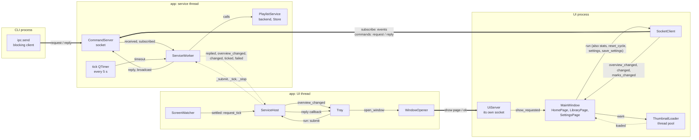
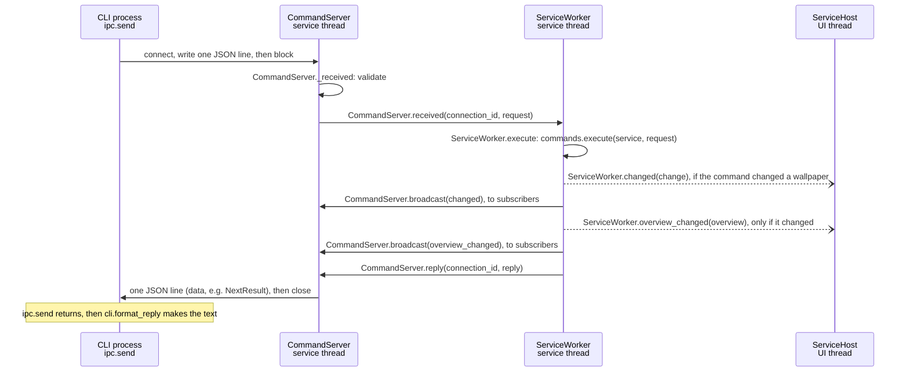
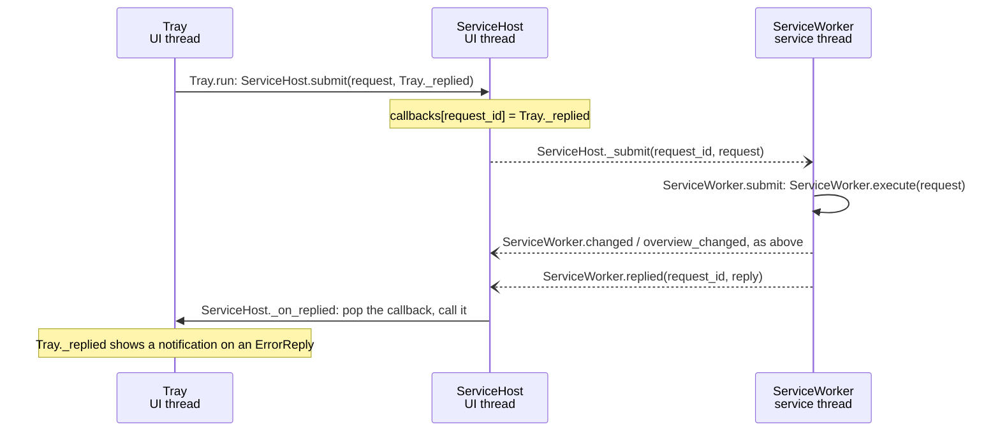
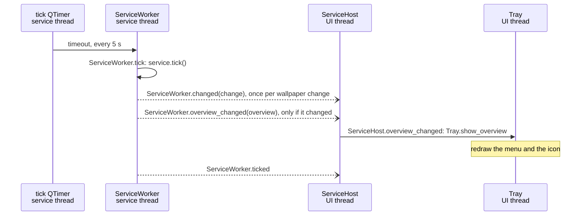
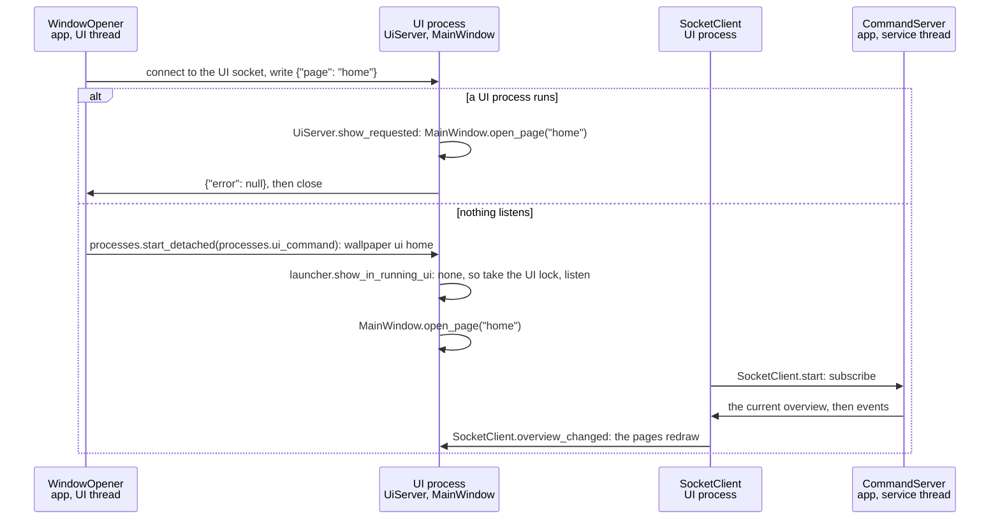
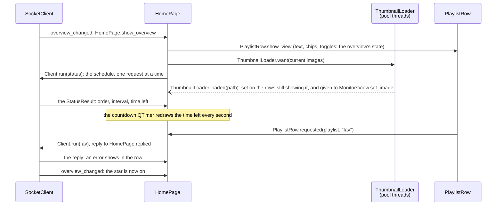
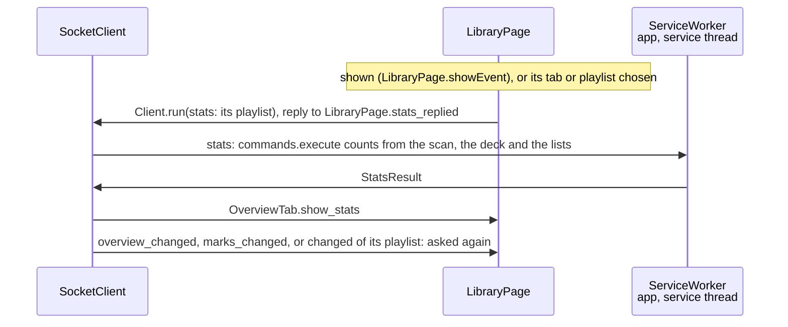

# App wiring

How the app's objects talk to each other: which process and thread each
lives on, and every signal connection between them. Written with class,
signal and slot names only (no line numbers); `tests/test_docs.py` checks
that every `Class.member` named here still exists, so renames can't
silently leave this page behind. For the reasons behind the design, see
[architecture.md](architecture.md#app-shell); for the messages on the
socket, [protocol.md](protocol.md).

Qt basics used below: `signal.emit(...)` calls every slot connected to the
signal. Within one thread that is a direct call. A **queued** connection
(used for every connection that crosses threads) instead posts the call to
the receiving thread's event loop, so the sender never waits.

## Processes, threads and who lives where

| Process / thread | Objects |
|---|---|
| **app**, UI thread (main thread, Qt event loop) | `QApplication`, `Tray`, `WindowOpener`, `ScreenWatcher`, and `ServiceHost`, the thin proxy to the service thread |
| **app**, service thread (`QThread` "playlist-service") | `ServiceWorker` and everything it creates on that thread: the `CommandServer` (socket), the tick `QTimer`, COM (`backends.thread_scope`), the backend, the SQLite `Store`, the `PlaylistService` |
| **UI process** (`wallpaper ui`, on demand), UI thread | `QApplication`, `UiServer` (its own socket), `SocketClient` (the app's socket), and the one `MainWindow`: its `ThumbnailLoader` (shared by Home and Settings), its `Sidebar` and its pages, `HomePage` (with its `PlaylistRow`s and `MonitorsView`), `LibraryPage` (with its `OverviewTab`), `SettingsPage` (with its `PlaylistEditor`s, a `MonitorsView` and the `AboutPage`) |
| **UI process**, thumbnail threads (the `ThumbnailLoader`'s own `QThreadPool`, 2 threads) | nothing that lives there: each job reads one image file with Pillow (a small copy, and the row's thumbnail as a `QImage`) and emits it back |
| **CLI** (a separate process) | `ipc.send`: blocking client, no event loop |

Only the service thread ever touches the `PlaylistService`, so the core needs
no locks. Everything that uses it goes through `ServiceWorker.execute`, so
socket requests, tray actions and ticks run one at a time on that thread.
Nothing there may block on a client (`waitFor*()`) or spin a nested event
loop. The UI thread never waits on it (except once, at shutdown).

The UI process is a client like the CLI: commands and a subscription over
the app's socket. Its window and pages use only the `Client` interface
(`Client.run`, `Client.overview_changed`, `Client.changed`,
`Client.marks_changed`, `Client.failed`), never the service or a socket.

## Overview

Solid arrows are direct calls within one thread; dashed arrows are queued
signals that cross from one thread to another; thick arrows are socket
lines between processes.



## Connections

### App

UI thread -> service thread (all queued; `ServiceHost` is the UI's only door in):

| Signal | Slot | Carries |
|---|---|---|
| `QThread.started` | `ServiceWorker.start` | - |
| `ServiceHost._submit` | `ServiceWorker.submit` (calls `ServiceWorker.execute`) | request id, a `CommandRequest` |
| `ServiceHost._tick` | `ServiceWorker.tick` | - (an extra tick) |
| `ServiceHost._stop` | `ServiceWorker.stop` | - |

Service thread -> UI thread (all queued):

| Signal | Slot / re-emitted as | Carries |
|---|---|---|
| `ServiceWorker.replied` | `ServiceHost._on_replied` (calls the stored callback) | request id, `Reply` |
| `ServiceWorker.overview_changed` | `ServiceHost._on_overview` -> `ServiceHost.overview_changed` | `Overview` |
| `ServiceWorker.changed` | `ServiceHost.changed` | `Change` (from a tick or a command) |
| `ServiceWorker.ticked` | `ServiceHost.ticked` | - |
| `ServiceWorker.failed` | `ServiceHost.failed` -> the handler in `runtime.run_app` (quits; `run_app` then raises the error) | message: the socket could not open |

Inside the service thread (direct):

| Signal / call | Slot / effect |
|---|---|
| tick `QTimer.timeout` (every 5 s) | `ServiceWorker.tick` |
| `CommandServer.received` | `ServiceWorker._answer` -> `ServiceWorker.execute`, then `CommandServer.reply` |
| `CommandServer.subscribed` | `ServiceWorker._welcome` -> `CommandServer.send_event` (the current `Overview`) |
| a change (tick or command) | `ServiceWorker._announce`: `ServiceWorker.changed` and `CommandServer.broadcast` |
| a new overview | `ServiceWorker._publish`: `ServiceWorker.overview_changed` and `CommandServer.broadcast` |
| the list files' stamp moved (`PlaylistService.lists_stamp`: paths, mtimes, sizes), checked after every tick and command | `ServiceWorker._publish_lists` (from `ServiceWorker._publish`): `CommandServer.broadcast` of `marks_changed` (subscribers only: the tray reads `favourite` from the overview) |
| an error from the service (a command, a tick, the overview) | `ServiceWorker._failed`: a `ConfigError` (a list file went bad) stops the service (`ServiceWorker._fail`; commands answer with it, and each tick tries to open it again), any other is logged |

Inside the UI thread (direct):

| Signal | Slot |
|---|---|
| `ScreenWatcher.settled` | `ServiceHost.request_tick` |
| `ServiceHost.overview_changed` | `Tray.show_overview` (redraws the menu) |
| tray menu items (playlist commands, including the *Hold* toggle) | `Tray.run` -> `ServiceHost.submit` (reply callback: `Tray._replied`) |
| *Open wallpaper_py* / *Library* / *Settings…* (the page: home, library, settings) | `Tray.open_window` -> `WindowOpener.open` |
| `WindowOpener.failed` | `Tray.notify` |
| `QSystemTrayIcon.messageClicked` | `Tray._message_clicked` (after the "No playlists yet" notification at start: `Tray.open_window` on Settings; other notifications open nothing) |
| *No playlists yet: add one…* (only without playlists) | `Tray.open_window` on Settings |

`ServiceWorker.start` creates the `CommandServer` once, then ticks; the
first tick opens the service (`ServiceWorker._open`). While the service is
down (it could not open, or a list file went bad), every
`ServiceWorker.tick` tries to open it again, logging the same error only
once; the socket keeps answering meanwhile, with the error.
`ServiceWorker.stop` closes the socket before the service, which also ends
every subscription.

`settings` and `save_settings` run in `commands.execute` like the playlist
commands. When a command's `Outcome.render` is set (a `save_settings`
that succeeded), `ServiceWorker.execute` calls `ServiceWorker.tick` instead
of only publishing, before replying: the monitors whose playlist or
look changed get their image rendered again (`ServiceWorker.changed`) and
the new overview is published, both before the reply.

### UI process

| Signal | Slot |
|---|---|
| `UiServer.show_requested` (a page) | `MainWindow.open_page` (shows that page and brings the window to the front) |
| `SocketClient.overview_changed`, `SocketClient.failed` | `MainWindow._show_status`, `MainWindow._show_failure` (the `Sidebar`'s status line) |
| `SocketClient.overview_changed`, `SocketClient.failed` | `HomePage.show_overview`, `HomePage.show_error` |
| `SocketClient.overview_changed`, `SocketClient.failed` | `SettingsPage.show_overview` (the monitors; the first one without an error loads the settings: `SettingsPage.load`), `SettingsPage.show_error` |
| `Sidebar.page_chosen` (a page's item clicked) | `MainWindow.show_page` |
| `HomePage.page_wanted` (*Add one in Settings*, shown without playlists) | `MainWindow.show_page` |
| `SettingsPage.modified` (unsaved edits come or go) | `MainWindow._modified` (the "*" in the title) |
| `PlaylistRow.hovered`, `MonitorsView.hovered` (the pointer: a playlist, or None) | `HomePage._hover` -> `MonitorsView.set_highlight`, `PlaylistRow.set_highlighted` |
| `PlaylistRow.requested` (a button: playlist, command) | `HomePage._send` -> `Client.run` (reply: `HomePage.replied`) |
| Home's countdown `QTimer` (every second, only while a playlist counts down) | `HomePage.refresh_schedule` |
| `ThumbnailLoader.loaded` (an image is ready) | `HomePage._thumbnail_loaded` (the rows and `MonitorsView` that still show it), `SettingsPage._image_loaded` (its `MonitorsView`) |
| `Tabs.current_changed` (Settings' sub-tabs) | `QStackedWidget.setCurrentIndex` |
| `SocketClient.overview_changed`, `SocketClient.changed`, `SocketClient.marks_changed`, `SocketClient.failed` | `LibraryPage.show_overview` (the playlists in its drop-down; the numbers again), `LibraryPage._changed` (a change of its playlist: the numbers again), `LibraryPage._marks_changed` (the numbers again), `LibraryPage.show_error` |
| `Tabs.current_changed` (the Library's tabs), the Library's *Playlist* drop-down's `currentIndexChanged` | `LibraryPage._tab_chosen`, `LibraryPage._playlist_chosen` (each remembered in ui-state.json; Overview: the numbers again) |
| `OverviewTab.rescan_requested`, `OverviewTab.reset_requested` | `LibraryPage._rescan_clicked` (`stats` with `rescan`), `LibraryPage._reset_clicked` (asks first; `reset_cycle`, reply to `LibraryPage.reset_replied`) |
| `PlaylistEditor.edited`, and the *General* tab's fields | `SettingsPage._edited` -> `SettingsPage._refresh` (problems, summaries, the monitor rows, Save / Revert, the status line, the drawing) |
| `PlaylistEditor.toggle_requested` (a playlist's header row clicked) | `SettingsPage._toggle_playlist` -> `SettingsPage.open_playlist` (the others close) |
| `MonitorsView.clicked` (a monitor's id; the Settings drawing is clickable) | `SettingsPage.select_monitor` (outlined; its rows below) |
| the *Monitor* drop-down's `currentIndexChanged` | `SettingsPage._monitor_chosen` -> `SettingsPage.select_monitor` |
| the *Playlist* drop-down's `currentIndexChanged`, *Forget monitor* | `SettingsPage._playlist_chosen`, `SettingsPage._forget` (the selected monitor's row in the draft) |
| the look's rows (settings_look.py): the *Mode* choice's `Segments.current_changed`, the *Background* drop-down's `currentIndexChanged`, the *Blur* and *Darken* sliders' `valueChanged` (also while dragged) | `LookEditor._mode_chosen`, `LookEditor._background_chosen`, `LookEditor._blur_moved`, `LookEditor._darken_moved` -> `LookEditor.edited` (the monitor shown, its new look) -> `SettingsPage._look_edited` (its row in the draft; the preview follows) |
| the background colour's swatch (`ColourButton.clicked`) | `LookEditor._choose_colour`: a modal `QColorDialog`, whose `currentColorChanged` goes to `LookEditor._colour_previewed` while it is open (-> `LookEditor.edited`: the draft and the preview follow the colour); Cancel puts the colour back |
| `PlaylistEditor.delete_requested`, `PlaylistEditor.browse_requested` | `SettingsPage._delete_playlist`, `SettingsPage._browse_folder` |
| *Save* / *Revert* / *Load the settings again* | `SettingsPage.save` (via `SettingsPage._save_clicked`), `SettingsPage.revert`, `SettingsPage.load` |
| `MainWindow.closed` (the window closed) | `process._Closer.window_closed`: `UiServer` closes; `QApplication.quit` now, or on `SocketClient.idle` if a command still waits for its reply (`SocketClient.busy`) |
| `SocketClient.ended` (the app quit) | `QApplication.quit` |

The pages live as long as the window: switching pages keeps everything,
unsaved settings included. The tones come from the application's palette
(`theme.derive_tones`); the window sets them as palette roles, and a
palette change (the system switching light / dark) reaches
`MainWindow.changeEvent`, which derives them again; painted widgets read
them when they paint.

Thumbnail threads -> UI thread (queued): each job emits `_Relay.done`,
which `ThumbnailLoader._done` receives on the UI thread; it makes the
`QPixmap` there, caches it, and emits `ThumbnailLoader.loaded`. The
monitor previews are rendered on the UI thread, when a `MonitorsView`
paints (a few ms each, cached; `MonitorsView.preview`).

`Client.run` sends each command on a connection of its own (an
`ipc.LineRequest`); the reply comes back to the callback on this thread.

## Flows

A command from the CLI (`wallpaper next konachan` while the app runs):



One id, one hop: `connection_id` tells `CommandServer` which socket gets
the reply. The request runs as soon as the service thread reads it, between
ticks.

If no app answers, the CLI runs the command itself and starts nothing
(`cli.send_to_app`): `ipc.send` returns None -> `InstanceLock.acquire()`
on the app's lock -> `Context.run_here` (`commands.open_service` +
`commands.execute`, no tick) -> lock released, the CLI exits. The lock held
but no answer (an app starting, or another CLI's command): `ipc.send`, then
the lock, again every 0.2 s for up to 10 s, then
`wallpaper_py is starting or busy and did not answer`. An app starting
while a CLI holds the lock waits up to 5 s for it (`runtime.LOCK_WAIT_S`).
`list` and `set` never need the app.

A tray click goes through `ServiceHost`, so the reply comes back to the UI
thread:



The worker never sees who asked: the socket's `connection_id` stays in
`CommandServer`, the tray's callback (by `request_id`) in `ServiceHost`.

Commands that change no wallpaper but the state the tray shows (*Hold*,
`hold` / `resume` from the CLI, *Favourite*) take the same path: after
every command `ServiceWorker.execute` calls `ServiceWorker._publish`, which
sends the new `Overview` to the tray (`Tray.show_overview` redraws the
toggle and the header) and to subscribers. The tray never flips its own
state: what it shows is always the service's.

A tick (every 5 s, or extra after a screen change):



(Each change and new overview also goes to subscribers, as in the CLI flow.)

Opening the window on a page (tray *Open wallpaper_py*, *Library* or
*Settings…*, or `wallpaper ui [home|library|settings]`):



`WindowOpener.open` never blocks (an `ipc.LineRequest`). A starting UI
process asks first, blocking, before its event loop runs
(`launcher.show_in_running_ui`); if another UI process answers, it exits.
Two starting at once: the UI lock (`paths.ui_lock`) keeps one, the other
asks it for up to 5 s. If the app isn't running, `SocketClient` starts it
(`processes.autostart_command`, detached, retried for 10 s) and
shows an error in the window (the sidebar says "Not connected") if it
doesn't come up.

Home, from an overview to a click (all on the UI process's UI thread
except the thumbnail jobs):



- It never polls: it redraws on `overview_changed`, and asks `status` once
  per new overview (the overview carries no schedule: the time left
  changes with every tick). Between overviews it counts the time left down
  itself, and only while the app does (not paused, held, manual or without
  an attached monitor).
- A toggle shows the overview's state: a click only sends the command
  (`fav` or `unfav`, `hold` or `resume`, chosen from the current state),
  and the next overview turns it on or off.
- Thumbnails, the monitor previews and image details (dimensions, file
  size) come from the files, on the `ThumbnailLoader`'s own pool: a job
  decodes once with Pillow at a reduced size (a small copy that covers
  the preview's longer side, and the row's thumbnail made from it);
  `ThumbnailLoader.want` takes jobs for images no longer shown off the
  queue, and drops a result that arrives for one anyway. Results are
  cached by path. `MonitorsView` renders each monitor's preview from the
  small copy with the renderer the app uses for the wallpaper, for the
  monitor's screen size and look (`DesktopMonitor.look`).
- A reply that arrives after the window closed is ignored (the callback
  holds the page weakly); closing the window waits for running jobs
  (`ThumbnailLoader.close`, by the window, which owns the loader; a page
  closes only a loader it made itself, as in tests).

The Settings page (the app keeps the settings; the page reads and writes
them only through its commands):

```mermaid
sequenceDiagram
    participant C as SocketClient
    participant S as SettingsPage
    participant W as ServiceWorker<br/>app, service thread

    C->>S: overview_changed: SettingsPage.show_overview (the monitors)
    S->>C: SettingsPage.load: Client.run(settings), reply to SettingsPage.loaded
    C->>S: SettingsResult: the settings and their revision
    Note over S: edits: a settings_draft.Draft; SettingsPage._refresh<br/>checks it (settings_draft.problems) after every change
    S->>C: SettingsPage.save: Client.run(save_settings: the whole edit, the revision)
    C->>W: save_settings: commands.execute stores and uses them,<br/>then ServiceWorker.tick renders what changed
    W->>C: overview_changed (every page redraws), then the SaveSettingsResult
    C->>S: SettingsPage.saved: the new revision, and the warnings if any
```

- Saved since they were read (`stale_settings`): nothing is saved; the page
  says so and offers *Load the settings again* (`SettingsPage.load`). A
  value the app refuses (`invalid_settings`): the message shows, the edits
  stay.
- Home follows a save through its overview like after any other change;
  the Settings page doesn't talk to it.
- Closing the window with unsaved settings shows the Settings page and asks
  Save / Discard / Cancel (`MainWindow.closeEvent` ->
  `SettingsPage.confirm_close`, before `MainWindow.closed`). Cancel, or a
  Save that can't happen, keeps the window open; Save sends the edit and
  keeps it open until the reply, then `SettingsPage.saved` closes it.

The Library page's Overview tab (the numbers come from the app; the page
reads nothing itself yet):



- It asks only while the Overview tab is on screen (page shown, tab
  current, a playlist chosen, the app without an error), one request at a
  time; what comes meanwhile asks once more after the reply. A reply for a
  playlist no longer chosen is dropped.
- *Reset cycle…* asks first (`library.confirm_reset`), then sends
  `reset_cycle`; the reply asks for the numbers again. A failure shows under
  the numbers (`OverviewTab.show_notice`).
- The playlist and the tab are view state (`ui_state.UiState` in
  `paths.ui_state`), written by `LibraryPage._remember` on each choice and
  read when the page is made.

Shutdown of the app (tray *Quit* or Ctrl+C): `app.quit()` ends the UI event
loop -> `ServiceHost.shutdown` emits `_stop` (queued) and waits for the
thread -> `ServiceWorker.stop` stops the timer, closes the socket (ending
every subscription), then the service (database, backend) and the COM
scope, and quits its thread. In the UI process the closed subscription
emits `SocketClient.ended`, which quits it too.

Shutdown of the UI process: its window closes -> `MainWindow.closed`
-> `UiServer` closes (no new show requests) -> `QApplication.quit`, at
once or, if a command is still in flight (its request is written on
later turns of the event loop), on
`SocketClient.idle` once its reply came -> the subscription closes; the lock is released and the process exits, which
gives its memory back. The app runs on.

Requests and ticks run on the same thread, one at a time, in arrival order:
a command never runs in the middle of a tick.
