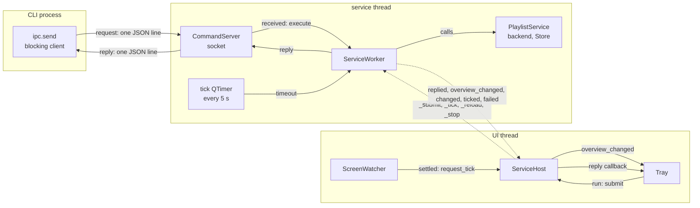
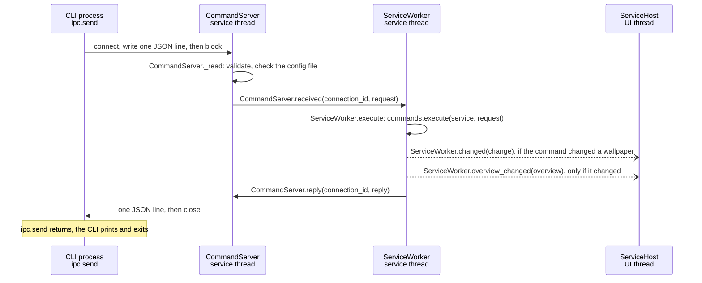
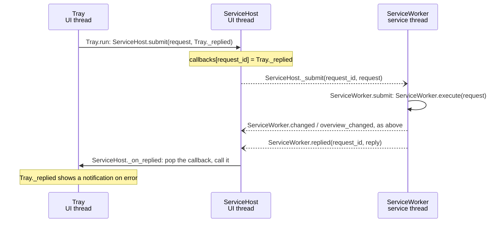
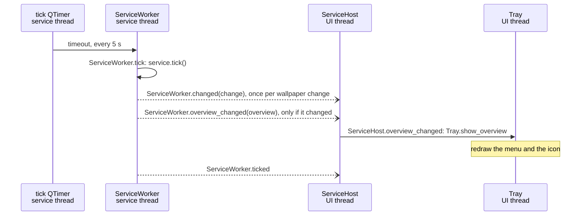

# App wiring

How the app's objects talk to each other: which thread each lives on, and
every signal connection between them. Written with class, signal and slot
names only (no line numbers); `tests/test_docs.py` checks that every
`Class.member` named here still exists, so renames can't silently leave this
page behind. For the reasons behind the design, see
[architecture.md](architecture.md#app-shell).

Qt basics used below: `signal.emit(...)` calls every slot connected to the
signal. Within one thread that is a direct call. A **queued** connection
(used for every connection that crosses threads) instead posts the call to
the receiving thread's event loop, so the sender never waits.

## Threads and who lives where

| Thread | Objects |
|---|---|
| **UI** (main thread, Qt event loop) | `QApplication`, `Tray`, `ScreenWatcher` (later: the windows), and `ServiceHost`, the thin proxy to the service thread |
| **service** (`QThread` "playlist-service") | `ServiceWorker` and everything it creates on that thread: the `CommandServer` (socket), the tick `QTimer`, COM (`backends.thread_scope`), the backend, the SQLite `Store`, the `PlaylistService` |
| **CLI** (a separate process) | `ipc.send`: blocking client, no event loop |

Only the service thread ever touches the `PlaylistService`, so the core needs
no locks. Everything that uses it goes through `ServiceWorker.execute`, so
socket requests, tray actions and ticks run one at a time on that thread.
Nothing there may block on a client (`waitFor*()`) or spin a nested event
loop. The UI thread never waits on it (except once, at shutdown).

## Overview

Solid arrows are direct calls within one thread; dashed arrows are queued
signals that cross from one thread to another.

## Connections

UI thread -> service thread (all queued; `ServiceHost` is the UI's only door in):

| Signal | Slot | Carries |
|---|---|---|
| `QThread.started` | `ServiceWorker.start` | - |
| `ServiceHost._submit` | `ServiceWorker.submit` (calls `ServiceWorker.execute`) | request id, `Request` |
| `ServiceHost._tick` | `ServiceWorker.tick` | - (an extra tick) |
| `ServiceHost._reload` | `ServiceWorker.reload` | - |
| `ServiceHost._stop` | `ServiceWorker.stop` | - |

Service thread -> UI thread (all queued):

| Signal | Slot / re-emitted as | Carries |
|---|---|---|
| `ServiceWorker.replied` | `ServiceHost._on_replied` (calls the stored callback) | request id, `Reply` |
| `ServiceWorker.overview_changed` | `ServiceHost._on_overview` -> `ServiceHost.overview_changed` | `Overview` |
| `ServiceWorker.changed` | `ServiceHost.changed` | `Change` (from a tick or a command) |
| `ServiceWorker.ticked` | `ServiceHost.ticked` | - |
| `ServiceWorker.failed` | `ServiceHost.failed` -> the handler in `runtime.run_app` (quits; `run_app` then raises the error) | message: the socket could not open |

Inside the service thread (direct):

| Signal | Slot |
|---|---|
| tick `QTimer.timeout` (every 5 s) | `ServiceWorker.tick` |
| `CommandServer.received` | `ServiceWorker._answer` -> `ServiceWorker.execute`, then `CommandServer.reply` |

Inside the UI thread (direct):

| Signal | Slot |
|---|---|
| `ScreenWatcher.settled` | `ServiceHost.request_tick` |
| `ServiceHost.overview_changed` | `Tray.show_overview` (redraws the menu) |
| tray menu items | `Tray.run` -> `ServiceHost.submit` (reply callback: `Tray._replied`) |

`ServiceWorker.start` creates the `CommandServer` once, before opening the
service; `ServiceWorker.reload` only closes and reopens the service, so the
socket keeps answering across reloads (with the config error while the
config is broken). `ServiceWorker.stop` closes the socket before the
service.

## Flows

A command from the CLI (`wallpaper next konachan` while the app runs):

One id, one hop: `connection_id` tells `CommandServer` which socket gets
the reply. The request runs as soon as the service thread reads it, between
ticks.

If no app answers, the CLI starts one and then sends: `ipc.send` returns
None -> `runtime.autostart_command` (the tray app, `pythonw` on Windows),
started detached so it outlives the CLI -> `ipc.send` again every 0.2 s for
up to 10 s; if nothing answers, the CLI prints
`could not start wallpaper_py; see <log file>`. Two CLIs may both start an
app: the instance lock keeps the first, the other exits, and both CLIs reach
the one that runs. `list` and `set` never need the app.

A tray click goes through `ServiceHost`, so the reply comes back to the UI
thread:

The worker never sees who asked: the socket's `connection_id` stays in
`CommandServer`, the tray's callback (by `request_id`) in `ServiceHost`.

A tick (every 5 s, or extra after a screen change):

A screen change: Qt's `screenAdded` / `screenRemoved` / geometry signals ->
`ScreenWatcher.poke` restarts a 2 s single-shot timer -> `ScreenWatcher.settled`
-> `ServiceHost.request_tick` -> one extra tick on the service thread.

Shutdown (tray *Quit* or Ctrl+C): `app.quit()` ends the UI event loop ->
`ServiceHost.shutdown` emits `_stop` (queued) and waits for the thread ->
`ServiceWorker.stop` stops the timer, closes the socket, then the service
(database, backend) and the COM scope, and quits its thread.

Requests and ticks run on the same thread, one at a time, in arrival order:
a command never runs in the middle of a tick.
