# App wiring

Which process and thread each object lives on, and diagrams of how they
talk. What an object does is in its module's docstring, why it is built
that way in [architecture.md](architecture.md), the socket's messages in
[protocol.md](protocol.md); the connections themselves are the
`connect()` calls in the code. `tests/test_docs.py` checks that every
`Class.member` named here still exists.

Qt basics used below: `signal.emit(...)` calls every slot connected to the
signal. Within one thread that is a direct call. A **queued** connection
(used for every connection that crosses threads) instead posts the call to
the receiving thread's event loop, so the sender never waits.

## Processes, threads and who lives where

| Process / thread | Objects |
|---|---|
| **daemon**, main thread (Qt event loop) | `QApplication`, `Tray`, `ScreenWatcher`, `ServiceThread` (the handle on the service thread) and its `LocalClient`, the tray's `Client` |
| **daemon**, service thread (`QThread` "playlist-service") | `ServiceWorker` and everything it creates on that thread: the `CommandServer` (socket), the tick `QTimer`, COM (`backends.thread_scope`), the backend, the SQLite `Store`, the `PlaylistService` |
| **window process** (`wallpaper ui`, on demand), main thread | `QApplication`, `SocketClient` (the daemon's socket, subscribed as the window), and the one `MainWindow`: its `ThumbnailLoader` (shared by Home and Settings), its `Sidebar` and its pages, `HomePage` (with its `PlaylistRow`s and `MonitorsView`), `LibraryPage` (with its `GridTab`s, each an `ImageGrid` and a `FastScroll`, its `StatsTab`, its `EnlargedView` with an `ImageCanvas`, the grids' `TileLoader` and `Pregenerator`, and a `LatestRead` each for the folder, the lists, the history and the enlarged image), `SettingsPage` (with its `PlaylistEditor`s, `LookEditor`, a `MonitorsView` and the About tab) |
| **window process**, pool threads (a `Jobs` each: `ThumbnailLoader` 2, `TileLoader` 4, `Pregenerator` 1 at low priority, each `LatestRead` 1) | nothing lives there: jobs read files (images, thumbnails, folders, the lists, the history, an image at full size) and hand their results to `Jobs.done` on the main thread |
| **CLI** (a separate process) | `ipc.send`: blocking client, no event loop |

## Overview

Solid arrows are direct calls within one thread; dashed arrows are queued
signals that cross from one thread to another; thick arrows are socket
lines between processes.

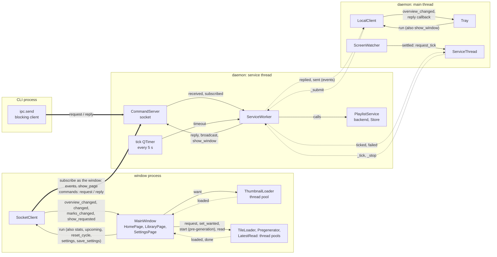

## Flows

A command from the CLI (`wallpaper next konachan`; if no daemon answers,
the CLI says so: `cli.send_to_daemon`):

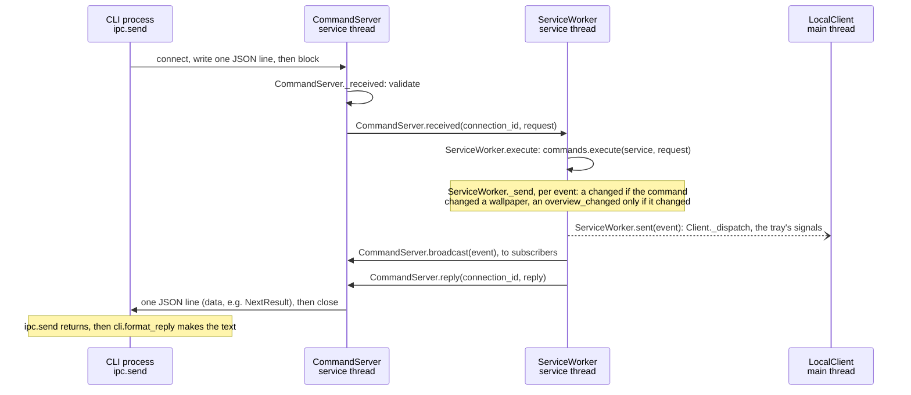

A tray click goes through the tray's `Client`, the `LocalClient` that
`ServiceThread` hands out, so the reply comes back to the main thread. The
worker never sees who asked: the socket's `connection_id` stays in
`CommandServer`, the tray's callback (by `request_id`) in `LocalClient`.

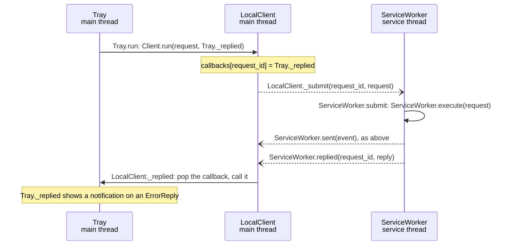

A tick (every 5 s, or extra after a screen change: `ScreenWatcher.settled`
-> `ServiceThread.request_tick`). Each event also goes to subscribers, as
in the CLI flow.

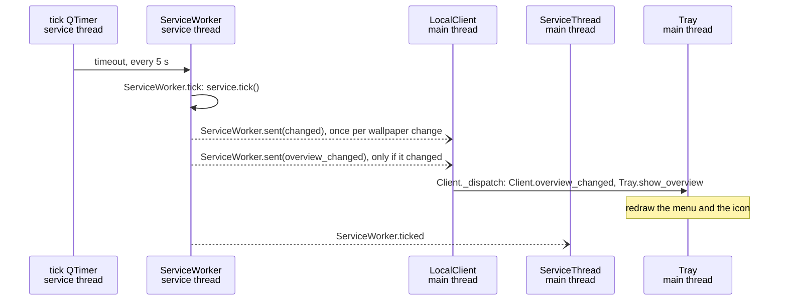

Opening the window on a page from the tray (*Open wallpaper_py*, *Library*
or *Settings…*). The daemon's socket knows which window process has the
window, so the tray asks it, and starts one only if none has; the service
thread never starts processes.

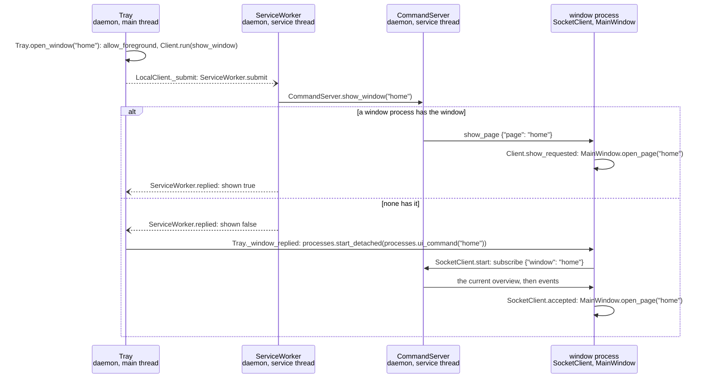

`wallpaper ui <page>` (from the tray as above, or typed) subscribes as the
window at once. If it found no daemon, it starts one and shows the window
right away, "Connecting…" (`SocketClient.daemon_started`). Two at once, or
one while a window is open: the service thread takes their subscriptions
one at a time, and the first is the window.

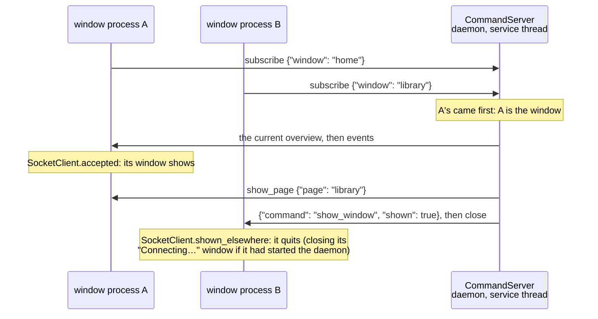

Home, from an overview to a click (all on the window process's main thread
except the thumbnail jobs):

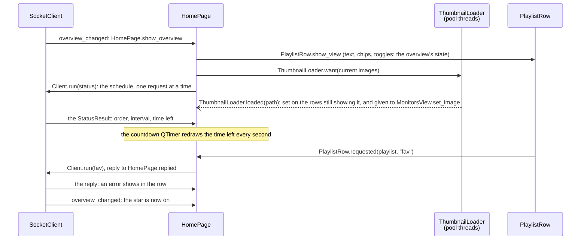

The Settings page (the daemon keeps the settings; the page reads and writes
them only through its commands):

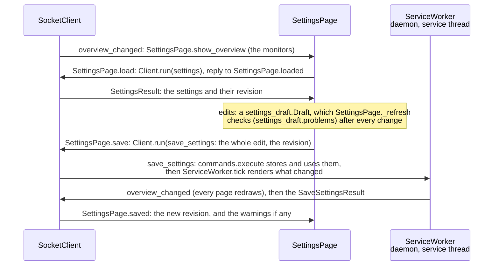

The Library page's Stats tab and Upcoming (from the daemon), one request
of each kind at a time:

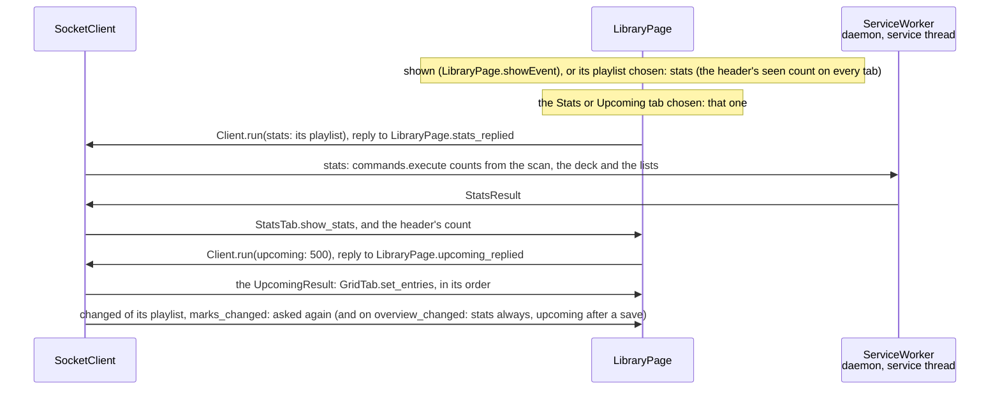

The grid tabs that the page reads itself, off the main thread (nothing
goes through the daemon):

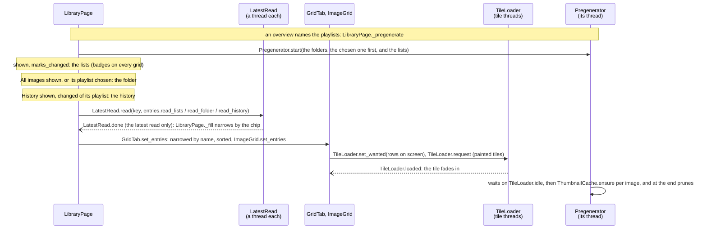

Shutdown. The daemon (tray *Quit* or Ctrl+C) stops its service thread, and
the closed subscription ends the window process too; the window process alone
ends when its window closes, and the daemon runs on:

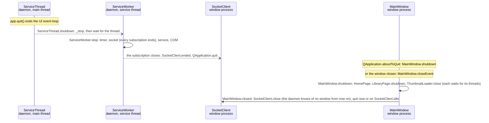
