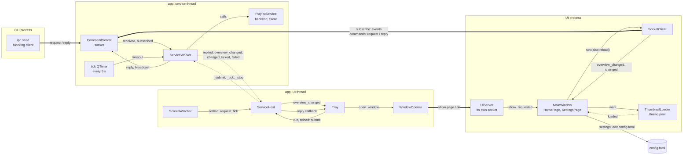
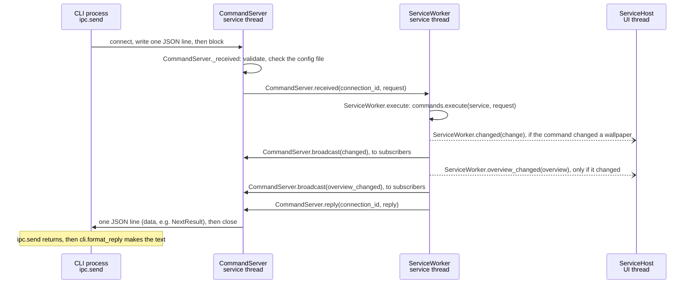
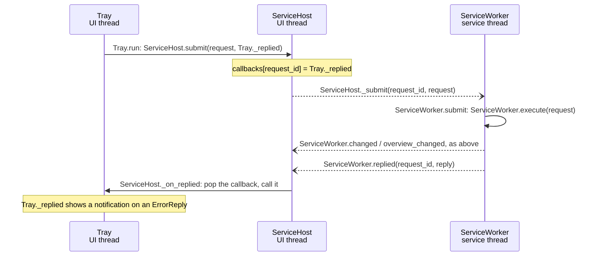
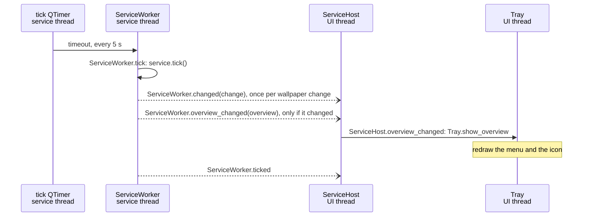
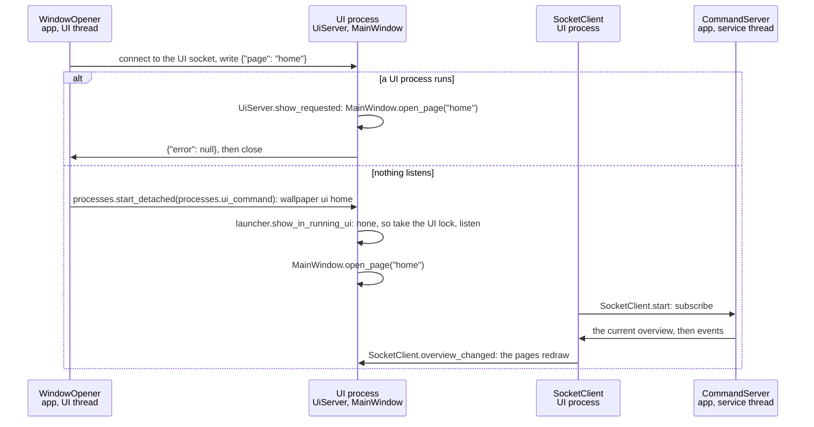
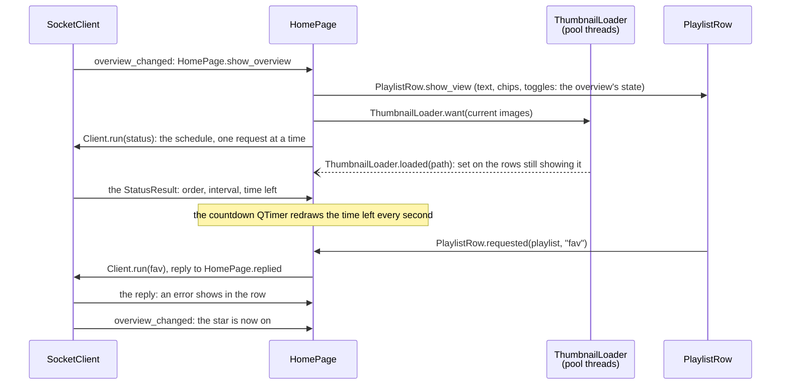

# App wiring

How the app's objects talk to each other: which process and thread each
lives on, and every signal connection between them. Written with class,
signal and slot names only (no line numbers); `tests/test_docs.py` checks
that every `Class.member` named here still exists, so renames can't
silently leave this page behind. For the reasons behind the design, see
[architecture.md](architecture.md#app-shell); for the messages on the
socket, [protocol.md](protocol.md).

Qt basics used below: `signal.emit(...)` calls every slot connected to the
signal. Within one thread that is a direct call. A **queued** connection
(used for every connection that crosses threads) instead posts the call to
the receiving thread's event loop, so the sender never waits.

## Processes, threads and who lives where

| Process / thread | Objects |
|---|---|
| **app**, UI thread (main thread, Qt event loop) | `QApplication`, `Tray`, `WindowOpener`, `ScreenWatcher`, and `ServiceHost`, the thin proxy to the service thread |
| **app**, service thread (`QThread` "playlist-service") | `ServiceWorker` and everything it creates on that thread: the `CommandServer` (socket), the tick `QTimer`, COM (`backends.thread_scope`), the backend, the SQLite `Store`, the `PlaylistService` |
| **UI process** (`wallpaper ui`, on demand), UI thread | `QApplication`, `UiServer` (its own socket), `SocketClient` (the app's socket), and the one `MainWindow`: its `Sidebar` and its pages, `HomePage` (with its `PlaylistRow`s, `MonitorsView` and `ThumbnailLoader`), `LibraryPage` (a placeholder until Phase 5), `SettingsPage` (with its `PlaylistEditor`s, a `MonitorsView` and the `AboutPage`) |
| **UI process**, thumbnail threads (the `ThumbnailLoader`'s own `QThreadPool`, 2 threads) | nothing that lives there: each job reads one image file into a `QImage` and emits it back |
| **CLI** (a separate process) | `ipc.send`: blocking client, no event loop |

Only the service thread ever touches the `PlaylistService`, so the core needs
no locks. Everything that uses it goes through `ServiceWorker.execute`, so
socket requests, tray actions and ticks run one at a time on that thread.
Nothing there may block on a client (`waitFor*()`) or spin a nested event
loop. The UI thread never waits on it (except once, at shutdown).

The UI process is a client like the CLI: commands and a subscription over
the app's socket. Its window and pages use only the `Client` interface
(`Client.run`, `Client.overview_changed`, `Client.changed`,
`Client.failed`), never the service or a socket.

## Overview

Solid arrows are direct calls within one thread; dashed arrows are queued
signals that cross from one thread to another; thick arrows are socket
lines between processes.



## Connections

### App

UI thread -> service thread (all queued; `ServiceHost` is the UI's only door in):

| Signal | Slot | Carries |
|---|---|---|
| `QThread.started` | `ServiceWorker.start` | - |
| `ServiceHost._submit` | `ServiceWorker.submit` (calls `ServiceWorker.execute`) | request id, `Request` (or `ReloadRequest`: `ServiceHost.reload` submits one) |
| `ServiceHost._tick` | `ServiceWorker.tick` | - (an extra tick) |
| `ServiceHost._stop` | `ServiceWorker.stop` | - |

Service thread -> UI thread (all queued):

| Signal | Slot / re-emitted as | Carries |
|---|---|---|
| `ServiceWorker.replied` | `ServiceHost._on_replied` (calls the stored callback) | request id, `Reply` |
| `ServiceWorker.overview_changed` | `ServiceHost._on_overview` -> `ServiceHost.overview_changed` | `Overview` |
| `ServiceWorker.changed` | `ServiceHost.changed` | `Change` (from a tick or a command) |
| `ServiceWorker.ticked` | `ServiceHost.ticked` | - |
| `ServiceWorker.failed` | `ServiceHost.failed` -> the handler in `runtime.run_app` (quits; `run_app` then raises the error) | message: the socket could not open |

Inside the service thread (direct):

| Signal / call | Slot / effect |
|---|---|
| tick `QTimer.timeout` (every 5 s) | `ServiceWorker.tick` |
| `CommandServer.received` | `ServiceWorker._answer` -> `ServiceWorker.execute`, then `CommandServer.reply` |
| `CommandServer.subscribed` | `ServiceWorker._welcome` -> `CommandServer.send_event` (the current `Overview`) |
| a change (tick or command) | `ServiceWorker._announce`: `ServiceWorker.changed` and `CommandServer.broadcast` |
| a new overview | `ServiceWorker._publish`: `ServiceWorker.overview_changed` and `CommandServer.broadcast` |

Inside the UI thread (direct):

| Signal | Slot |
|---|---|
| `ScreenWatcher.settled` | `ServiceHost.request_tick` |
| `ServiceHost.overview_changed` | `Tray.show_overview` (redraws the menu) |
| tray menu items (playlist commands, including the *Hold* toggle) | `Tray.run` -> `ServiceHost.submit` (reply callback: `Tray._replied`) |
| *Reload config* | `Tray.reload` -> `ServiceHost.reload`, the `reload` command (reply callback: `Tray._reloaded`: the error or the warnings, one notification) |
| *Open wallpaper_py* / *Library* / *Settings…* (the page: home, library, settings) | `Tray.open_window` -> `WindowOpener.open` |
| `WindowOpener.failed` | `Tray.notify` |

`ServiceWorker.start` creates the `CommandServer` once, before opening the
service. `reload` is a command like the others (from the socket, the
tray's *Reload config* or the Settings page), run by
`ServiceWorker.execute` itself rather than by `commands.execute`: it only
closes and reopens the service, then ticks (which publishes the new
overview) and replies with the warnings or the config error. The socket
keeps answering across reloads (with the config error while the config is
broken). `ServiceWorker.stop` closes the socket before the
service, which also ends every subscription.

### UI process

| Signal | Slot |
|---|---|
| `UiServer.show_requested` (a page) | `MainWindow.open_page` (shows that page and brings the window to the front) |
| `SocketClient.overview_changed` | `UiServer.follow` (without --config, the window uses the app's config, which the overview names) |
| `SocketClient.overview_changed`, `SocketClient.failed` | `MainWindow._show_status`, `MainWindow._show_failure` (the `Sidebar`'s status line) |
| `SocketClient.overview_changed`, `SocketClient.failed` | `HomePage.show_overview`, `HomePage.show_error` |
| `SocketClient.overview_changed`, `SocketClient.failed` | `SettingsPage.show_overview` (the first one names the file to edit; the monitors for the drawing), `SettingsPage.show_error` |
| `Sidebar.page_chosen` (a page's item clicked) | `MainWindow.show_page` |
| `SettingsPage.modified` (unsaved edits come or go) | `MainWindow._modified` (the "*" in the title) |
| `PlaylistRow.hovered`, `MonitorsView.hovered` (the pointer: a playlist, or None) | `HomePage._hover` -> `MonitorsView.set_highlight`, `PlaylistRow.set_highlighted` |
| `PlaylistRow.requested` (a button: playlist, command) | `HomePage._send` -> `Client.run` (reply: `HomePage.replied`) |
| Home's countdown `QTimer` (every second, only while a playlist counts down) | `HomePage.refresh_schedule` |
| `ThumbnailLoader.loaded` (an image is ready) | `HomePage._thumbnail_loaded` (the rows and `MonitorsView` that still show it) |
| `Tabs.current_changed` (Settings' sub-tabs) | `QStackedWidget.setCurrentIndex` |
| `PlaylistEditor.edited`, and the *General* tab's fields | `SettingsPage._edited` -> `SettingsPage._refresh` (problems, summaries, Save / Revert, the status line, the drawing) |
| `PlaylistEditor.open_requested` (a closed playlist's summary row clicked) | `SettingsPage.open_playlist` (the others close) |
| `MonitorsView.clicked` (a monitor's id; the Settings drawing is clickable) | `SettingsPage._monitor_clicked` -> `SettingsPage.monitor_menu` (pops up) |
| a playlist's *Monitors* menu `QMenu.aboutToShow` | `SettingsPage._fill_monitors_menu` |
| `QMenu.triggered` (either menu; the item's data says what) | `SettingsPage._menu_triggered` -> `SettingsPage.choose` |
| `PlaylistEditor.delete_requested`, `PlaylistEditor.browse_requested` | `SettingsPage._delete_playlist`, `SettingsPage._browse_folder` |
| *Save* / *Revert* / *Load the file again* | `SettingsPage.save` (via `SettingsPage._save_clicked`), `SettingsPage.revert`, `SettingsPage.load_file` |
| `MainWindow.closed` (the window closed) | `QApplication.quit` |
| `SocketClient.ended` (the app quit) | `QApplication.quit` |

The pages live as long as the window: switching pages keeps everything,
unsaved settings included. The tones come from the application's palette
(`theme.derive_tones`); the window sets them as palette roles, and a
palette change (the system switching light / dark) reaches
`MainWindow.changeEvent`, which derives them again; painted widgets read
them when they paint.

Thumbnail threads -> UI thread (queued): each job emits `_Relay.done`,
which `ThumbnailLoader._done` receives on the UI thread; it makes the
`QPixmap` there, caches it, and emits `ThumbnailLoader.loaded`.

`Client.run` sends each command on a connection of its own (an
`ipc.LineRequest`); the reply comes back to the callback on this thread.

## Flows

A command from the CLI (`wallpaper next konachan` while the app runs):



One id, one hop: `connection_id` tells `CommandServer` which socket gets
the reply. The request runs as soon as the service thread reads it, between
ticks.

If no app answers, the CLI runs the command itself and starts nothing
(`cli.send_to_app`): `ipc.send` returns None -> `InstanceLock.acquire()`
on the app's lock -> `Context.run_here` (`commands.open_service` +
`commands.execute`, no tick) -> lock released, the CLI exits. The lock held
but no answer (an app starting, or another CLI's command): `ipc.send`, then
the lock, again every 0.2 s for up to 10 s, then
`wallpaper_py is starting or busy and did not answer`. An app starting
while a CLI holds the lock waits up to 5 s for it (`runtime.LOCK_WAIT_S`).
`list` and `set` never need the app.

A tray click goes through `ServiceHost`, so the reply comes back to the UI
thread:



The worker never sees who asked: the socket's `connection_id` stays in
`CommandServer`, the tray's callback (by `request_id`) in `ServiceHost`.

Commands that change no wallpaper but the state the tray shows (*Hold*,
`hold` / `resume` from the CLI, *Favourite*) take the same path: after
every command `ServiceWorker.execute` calls `ServiceWorker._publish`, which
sends the new `Overview` to the tray (`Tray.show_overview` redraws the
toggle and the header) and to subscribers. The tray never flips its own
state: what it shows is always the service's.

A tick (every 5 s, or extra after a screen change):



(Each change and new overview also goes to subscribers, as in the CLI flow.)

Opening the window on a page (tray *Open wallpaper_py*, *Library* or
*Settings…*, or `wallpaper ui [home|library|settings]`):



`WindowOpener.open` never blocks (an `ipc.LineRequest`). A starting UI
process asks first, blocking, before its event loop runs
(`launcher.show_in_running_ui`); if another UI process answers, it exits.
Two starting at once: the UI lock (`paths.ui_lock`) keeps one, the other
asks it for up to 5 s. If the app isn't running, `SocketClient` starts it
(`processes.autostart_command`, detached, retried for 10 s) and
shows an error in the window (the sidebar says "Not connected") if it
doesn't come up.

Home, from an overview to a click (all on the UI process's UI thread
except the thumbnail jobs):



- It never polls: it redraws on `overview_changed`, and asks `status` once
  per new overview (the overview carries no schedule: the time left
  changes with every tick). Between overviews it counts the time left down
  itself, and only while the app does (not paused, held, manual or without
  an attached monitor).
- A toggle shows the overview's state: a click only sends the command
  (`fav` or `unfav`, `hold` or `resume`, chosen from the current state),
  and the next overview turns it on or off.
- Thumbnails and image details (dimensions from the header, file size)
  come from the files, on the `ThumbnailLoader`'s own pool: a job decodes
  at a reduced size into a `QImage`; `ThumbnailLoader.want` takes jobs for
  images no longer shown off the queue, and drops a result that arrives
  for one anyway. Results are cached by path.
- A reply that arrives after the window closed is ignored (the callback
  holds the page weakly); closing the window waits for running jobs
  (`HomePage.shutdown` -> `ThumbnailLoader.close`).

Saving on the Settings page (the UI process edits config.toml like an
editor would; the app only reads it again):

```mermaid
sequenceDiagram
    participant C as SocketClient
    participant S as SettingsPage
    participant F as config.toml
    participant W as ServiceWorker<br/>app, service thread

    C->>S: overview_changed: SettingsPage.show_overview (names the app's file)
    S->>F: SettingsPage.load_file: read it, as text
    Note over S: edits: SettingsPage._refresh validates every change,<br/>renders the new text and checks it with the core's parser
    S->>F: SettingsPage.save: still what was read? then write (temp + replace)
    S->>C: Client.run(reload), reply to SettingsPage.reloaded
    C->>W: reload: ServiceWorker.execute closes and reopens the service
    W->>C: overview_changed (every page redraws), then the ReloadResult
    C->>S: the reply: "Saved; the app is using it", or the config error
```

- Only what changed is written (`core.config_edit.render`, tomlkit): no
  change gives the identical file, an edit touches only its own lines, and
  comments stay.
- The file changed on disk since the page read it (a hand edit): nothing
  is written; the window says so and offers *Load the file again*
  (`SettingsPage.load_file`).
- Home follows the reload through its overview like after any other
  change; the Settings page doesn't talk to it.
- Closing the window with unsaved settings shows the Settings page and asks
  Save / Discard / Cancel (`MainWindow.closeEvent` ->
  `SettingsPage.confirm_close`, before `MainWindow.closed`); Cancel, or a
  Save that can't happen, keeps the window open.

Shutdown of the app (tray *Quit* or Ctrl+C): `app.quit()` ends the UI event
loop -> `ServiceHost.shutdown` emits `_stop` (queued) and waits for the
thread -> `ServiceWorker.stop` stops the timer, closes the socket (ending
every subscription), then the service (database, backend) and the COM
scope, and quits its thread. In the UI process the closed subscription
emits `SocketClient.ended`, which quits it too.

Shutdown of the UI process: its window closes -> `MainWindow.closed`
-> `QApplication.quit` -> `UiServer` closes first (no new show requests),
then the subscription; the lock is released and the process exits, which
gives its memory back. The app runs on.

Requests and ticks run on the same thread, one at a time, in arrival order:
a command never runs in the middle of a tick.
