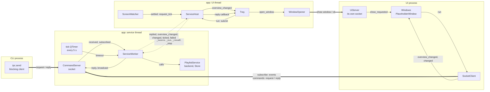
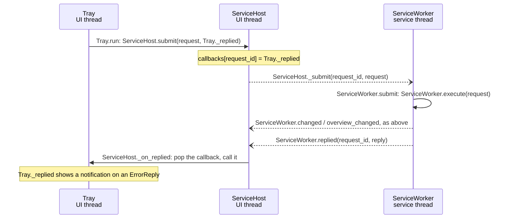
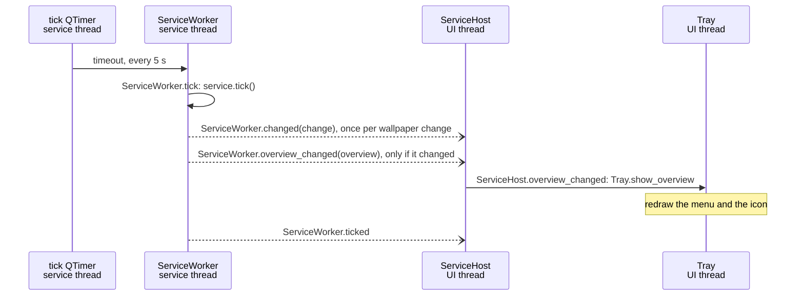
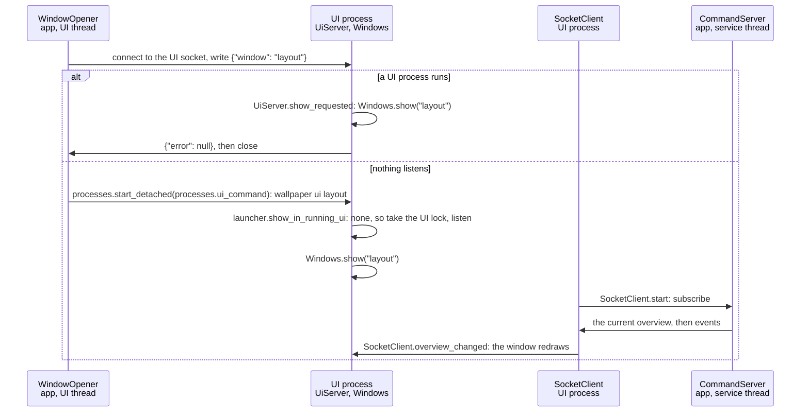

# App wiring

How the app's objects talk to each other: which process and thread each
lives on, and every signal connection between them. Written with class,
signal and slot names only (no line numbers); `tests/test_docs.py` checks
that every `Class.member` named here still exists, so renames can't
silently leave this page behind. For the reasons behind the design, see
[architecture.md](architecture.md#app-shell); for the messages on the
socket, [protocol.md](protocol.md).

Qt basics used below: `signal.emit(...)` calls every slot connected to the
signal. Within one thread that is a direct call. A **queued** connection
(used for every connection that crosses threads) instead posts the call to
the receiving thread's event loop, so the sender never waits.

## Processes, threads and who lives where

| Process / thread | Objects |
|---|---|
| **app**, UI thread (main thread, Qt event loop) | `QApplication`, `Tray`, `WindowOpener`, `ScreenWatcher`, and `ServiceHost`, the thin proxy to the service thread |
| **app**, service thread (`QThread` "playlist-service") | `ServiceWorker` and everything it creates on that thread: the `CommandServer` (socket), the tick `QTimer`, COM (`backends.thread_scope`), the backend, the SQLite `Store`, the `PlaylistService` |
| **UI process** (`wallpaper ui`, on demand; one thread) | `QApplication`, `UiServer` (its own socket), `SocketClient` (the app's socket), `Windows` and the windows (`PlaceholderWindow` for now) |
| **CLI** (a separate process) | `ipc.send`: blocking client, no event loop |

Only the service thread ever touches the `PlaylistService`, so the core needs
no locks. Everything that uses it goes through `ServiceWorker.execute`, so
socket requests, tray actions and ticks run one at a time on that thread.
Nothing there may block on a client (`waitFor*()`) or spin a nested event
loop. The UI thread never waits on it (except once, at shutdown).

The UI process is a client like the CLI: commands and a subscription over
the app's socket. Its windows use only the `Client` interface
(`Client.run`, `Client.overview_changed`, `Client.changed`,
`Client.failed`), never the service or a socket.

## Overview

Solid arrows are direct calls within one thread; dashed arrows are queued
signals that cross from one thread to another; thick arrows are socket
lines between processes.



## Connections

### App

UI thread -> service thread (all queued; `ServiceHost` is the UI's only door in):

| Signal | Slot | Carries |
|---|---|---|
| `QThread.started` | `ServiceWorker.start` | - |
| `ServiceHost._submit` | `ServiceWorker.submit` (calls `ServiceWorker.execute`) | request id, `Request` |
| `ServiceHost._tick` | `ServiceWorker.tick` | - (an extra tick) |
| `ServiceHost._reload` | `ServiceWorker.reload` | - |
| `ServiceHost._stop` | `ServiceWorker.stop` | - |

Service thread -> UI thread (all queued):

| Signal | Slot / re-emitted as | Carries |
|---|---|---|
| `ServiceWorker.replied` | `ServiceHost._on_replied` (calls the stored callback) | request id, `Reply` |
| `ServiceWorker.overview_changed` | `ServiceHost._on_overview` -> `ServiceHost.overview_changed` | `Overview` |
| `ServiceWorker.changed` | `ServiceHost.changed` | `Change` (from a tick or a command) |
| `ServiceWorker.ticked` | `ServiceHost.ticked` | - |
| `ServiceWorker.failed` | `ServiceHost.failed` -> the handler in `runtime.run_app` (quits; `run_app` then raises the error) | message: the socket could not open |

Inside the service thread (direct):

| Signal / call | Slot / effect |
|---|---|
| tick `QTimer.timeout` (every 5 s) | `ServiceWorker.tick` |
| `CommandServer.received` | `ServiceWorker._answer` -> `ServiceWorker.execute`, then `CommandServer.reply` |
| `CommandServer.subscribed` | `ServiceWorker._welcome` -> `CommandServer.send_event` (the current `Overview`) |
| a change (tick or command) | `ServiceWorker._announce`: `ServiceWorker.changed` and `CommandServer.broadcast` |
| a new overview | `ServiceWorker._publish`: `ServiceWorker.overview_changed` and `CommandServer.broadcast` |

Inside the UI thread (direct):

| Signal | Slot |
|---|---|
| `ScreenWatcher.settled` | `ServiceHost.request_tick` |
| `ServiceHost.overview_changed` | `Tray.show_overview` (redraws the menu) |
| tray menu items (playlist commands, including the *Hold* toggle) | `Tray.run` -> `ServiceHost.submit` (reply callback: `Tray._replied`) |
| *Open layout* / *Open library* | `Tray.open_window` -> `WindowOpener.open` |
| `WindowOpener.failed` | `Tray.notify` |

`ServiceWorker.start` creates the `CommandServer` once, before opening the
service; `ServiceWorker.reload` only closes and reopens the service, so the
socket keeps answering across reloads (with the config error while the
config is broken). `ServiceWorker.stop` closes the socket before the
service, which also ends every subscription.

### UI process

| Signal | Slot |
|---|---|
| `UiServer.show_requested` | `Windows.show` (creates the window or raises it) |
| `SocketClient.overview_changed`, `SocketClient.changed`, `SocketClient.failed` | the windows (`PlaceholderWindow.show_overview`, `PlaceholderWindow.show_change`, `PlaceholderWindow.show_error`) |
| `Windows.all_closed` (the last window closed) | `QApplication.quit` |
| `SocketClient.ended` (the app quit) | `QApplication.quit` |

`Client.run` sends each command on a connection of its own (an
`ipc.LineRequest`); the reply comes back to the callback on this thread.

## Flows

A command from the CLI (`wallpaper next konachan` while the app runs):

```mermaid
sequenceDiagram
    participant CLI as CLI process<br/>ipc.send
    participant S as CommandServer<br/>service thread
    participant W as ServiceWorker<br/>service thread
    participant H as ServiceHost<br/>UI thread

    CLI->>S: connect, write one JSON line, then block
    S->>S: CommandServer._received: validate, check the config file
    S->>W: CommandServer.received(connection_id, request)
    W->>W: ServiceWorker.execute: commands.execute(service, request)
    W--)H: ServiceWorker.changed(change), if the command changed a wallpaper
    W->>S: CommandServer.broadcast(changed), to subscribers
    W--)H: ServiceWorker.overview_changed(overview), only if it changed
    W->>S: CommandServer.broadcast(overview_changed), to subscribers
    W->>S: CommandServer.reply(connection_id, reply)
    S->>CLI: one JSON line (data, e.g. NextResult), then close
    Note over CLI: ipc.send returns; cli.format_reply makes the text
```

One id, one hop: `connection_id` tells `CommandServer` which socket gets
the reply. The request runs as soon as the service thread reads it, between
ticks.

If no app answers, the CLI starts one and then sends: `ipc.send` returns
None -> `processes.start_detached` runs `processes.autostart_command` (the
tray app, `pythonw` on Windows), so it outlives the CLI -> `ipc.send` again
every 0.2 s for up to 10 s; if nothing answers, the CLI prints
`could not start wallpaper_py; see <log file>`. Two CLIs may both start an
app: the instance lock keeps the first, the other exits, and both CLIs reach
the one that runs. `list` and `set` never need the app.

A tray click goes through `ServiceHost`, so the reply comes back to the UI
thread:



The worker never sees who asked: the socket's `connection_id` stays in
`CommandServer`, the tray's callback (by `request_id`) in `ServiceHost`.

Commands that change no wallpaper but the state the tray shows (*Hold*,
`hold` / `resume` from the CLI, *Favourite*) take the same path: after
every command `ServiceWorker.execute` calls `ServiceWorker._publish`, which
sends the new `Overview` to the tray (`Tray.show_overview` redraws the
toggle and the header) and to subscribers. The tray never flips its own
state: what it shows is always the service's.

A tick (every 5 s, or extra after a screen change):



(Each change and new overview also goes to subscribers, as in the CLI flow.)

Opening a window (tray *Open layout*, or `wallpaper ui layout`):



`WindowOpener.open` never blocks (an `ipc.LineRequest`). A starting UI
process asks first, blocking, before its event loop runs
(`launcher.show_in_running_ui`); if another UI process answers, it exits.
Two starting at once: the UI lock (`paths.ui_lock`) keeps one, the other
asks it for up to 5 s. If the app isn't running, `SocketClient` starts it
like the CLI does (`processes.autostart_command`, retried for 10 s) and
shows an error in the window if it doesn't come up.

Shutdown of the app (tray *Quit* or Ctrl+C): `app.quit()` ends the UI event
loop -> `ServiceHost.shutdown` emits `_stop` (queued) and waits for the
thread -> `ServiceWorker.stop` stops the timer, closes the socket (ending
every subscription), then the service (database, backend) and the COM
scope, and quits its thread. In the UI process the closed subscription
emits `SocketClient.ended`, which quits it too.

Shutdown of the UI process: its last window closes -> `Windows.all_closed`
-> `QApplication.quit` -> `UiServer` closes first (no new show requests),
then the subscription; the lock is released and the process exits, which
gives its memory back. The app runs on.

Requests and ticks run on the same thread, one at a time, in arrival order:
a command never runs in the middle of a tick.
