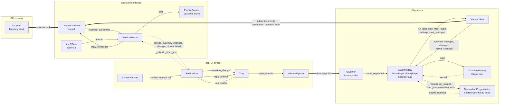
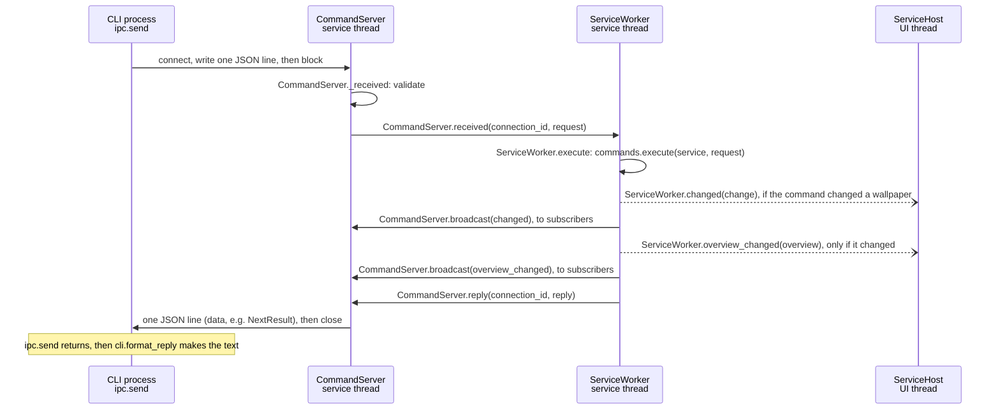
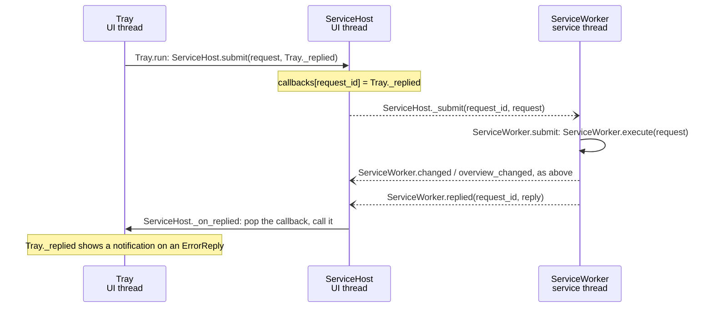
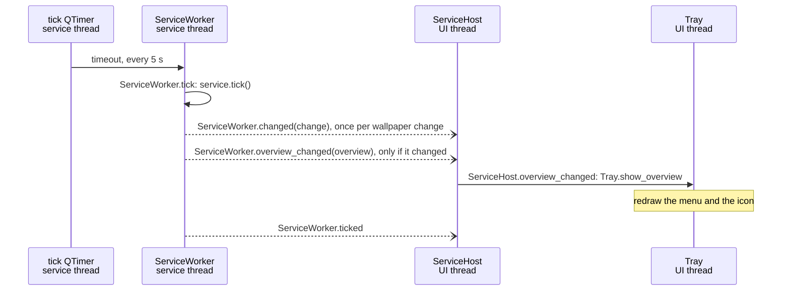
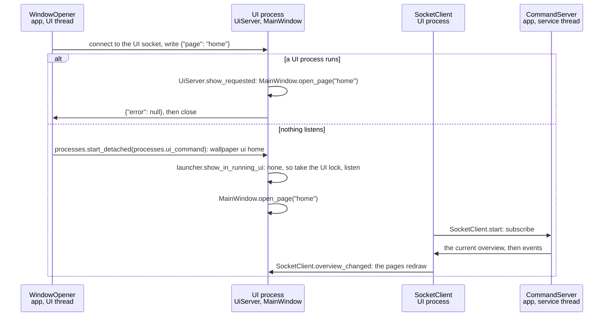
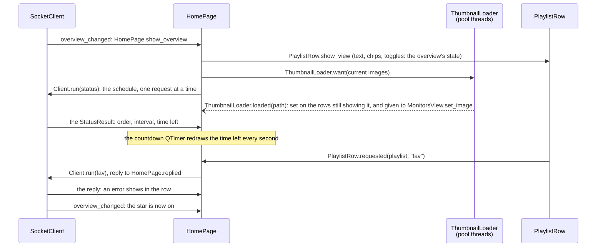
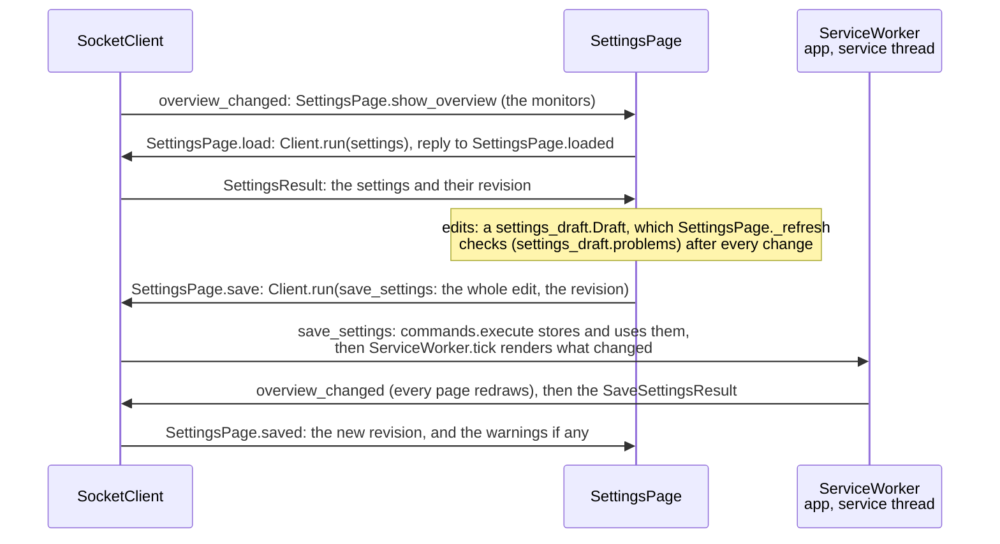
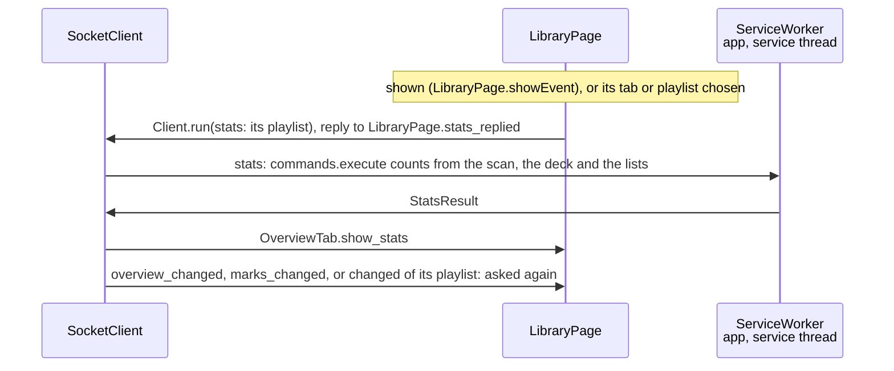
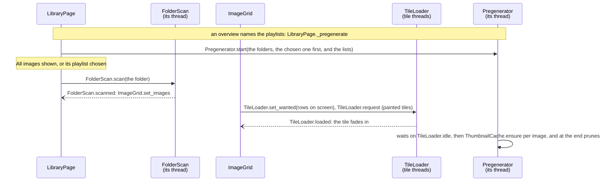
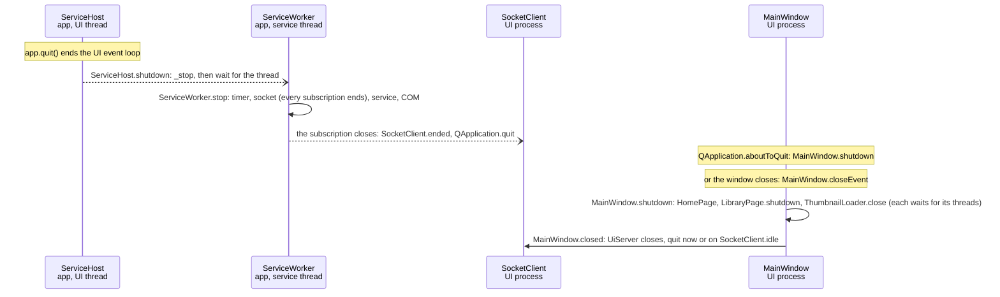

# App wiring

Which process and thread each object lives on, and diagrams of how they
talk. What an object does is in its module's docstring, why it is built
that way in [architecture.md](architecture.md), the socket's messages in
[protocol.md](protocol.md); the connections themselves are the
`connect()` calls in the code. `tests/test_docs.py` checks that every
`Class.member` named here still exists.

Qt basics used below: `signal.emit(...)` calls every slot connected to the
signal. Within one thread that is a direct call. A **queued** connection
(used for every connection that crosses threads) instead posts the call to
the receiving thread's event loop, so the sender never waits.

## Processes, threads and who lives where

| Process / thread | Objects |
|---|---|
| **app**, UI thread (main thread, Qt event loop) | `QApplication`, `Tray`, `WindowOpener`, `ScreenWatcher`, and `ServiceHost`, the thin proxy to the service thread |
| **app**, service thread (`QThread` "playlist-service") | `ServiceWorker` and everything it creates on that thread: the `CommandServer` (socket), the tick `QTimer`, COM (`backends.thread_scope`), the backend, the SQLite `Store`, the `PlaylistService` |
| **UI process** (`wallpaper ui`, on demand), UI thread | `QApplication`, `UiServer` (its own socket), `SocketClient` (the app's socket), and the one `MainWindow`: its `ThumbnailLoader` (shared by Home and Settings), its `Sidebar` and its pages, `HomePage` (with its `PlaylistRow`s and `MonitorsView`), `LibraryPage` (with its `OverviewTab`, the All images `ImageGrid`, and the grids' `TileLoader`, `Pregenerator` and `FolderScan`), `SettingsPage` (with its `PlaylistEditor`s, `LookEditor`, a `MonitorsView` and the About tab) |
| **UI process**, pool threads (a `Jobs` each: `ThumbnailLoader` 2, `TileLoader` 4, `Pregenerator` 1 at low priority, `FolderScan` 1) | nothing lives there: jobs read files (images, thumbnails, folders) and hand their results to `Jobs.done` on the UI thread |
| **CLI** (a separate process) | `ipc.send`: blocking client, no event loop |

## Overview

Solid arrows are direct calls within one thread; dashed arrows are queued
signals that cross from one thread to another; thick arrows are socket
lines between processes.

## Flows

A command from the CLI (`wallpaper next konachan` while the app runs; if
none answers, the CLI runs it itself: `cli.send_to_app`):

A tray click goes through `ServiceHost`, so the reply comes back to the UI
thread. The worker never sees who asked: the socket's `connection_id`
stays in `CommandServer`, the tray's callback (by `request_id`) in
`ServiceHost`.

A tick (every 5 s, or extra after a screen change: `ScreenWatcher.settled`
-> `ServiceHost.request_tick`). Each change and new overview also goes to
subscribers, as in the CLI flow.

Opening the window on a page (tray *Open wallpaper_py*, *Library* or
*Settings…*, or `wallpaper ui [home|library|settings]`):

Home, from an overview to a click (all on the UI process's UI thread
except the thumbnail jobs):

The Settings page (the app keeps the settings; the page reads and writes
them only through its commands):

The Library page's Overview tab (the numbers come from the app):

The Library page's All images tab (the page reads the folder and the
images itself, off the UI thread; nothing goes through the app):

Shutdown. The app (tray *Quit* or Ctrl+C) stops its service thread, and
the closed subscription ends the UI process too; the UI process alone
ends when its window closes, and the app runs on:

